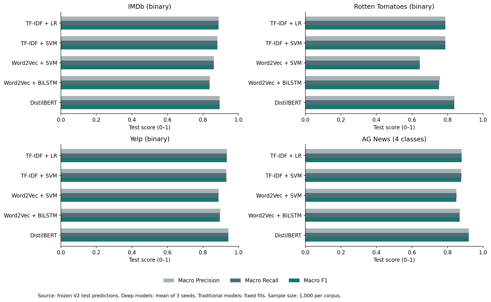
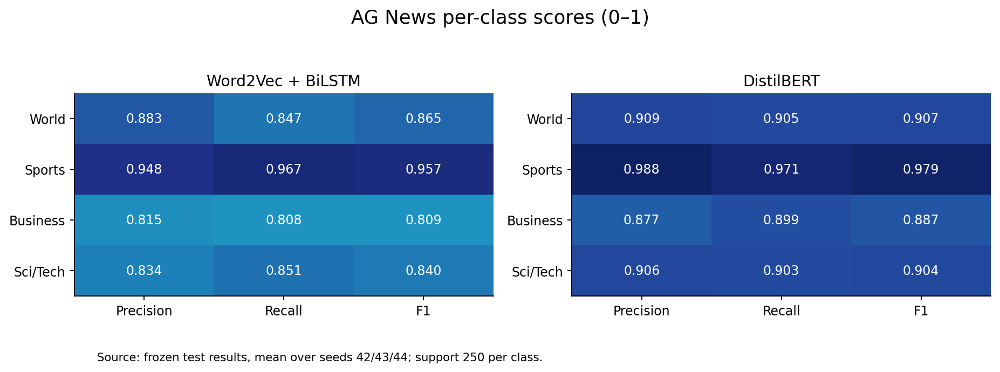
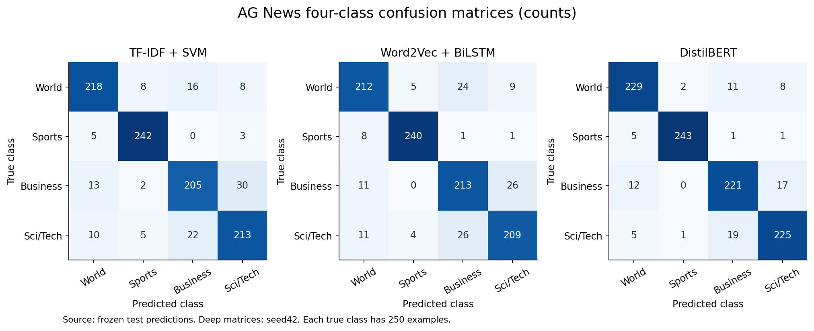

# Traditional NLP and Deep Learning for Binary and Multiclass Text Classification

## Scope and course alignment

This V2 extends the completed sentiment project at the user's request. The GUI is English throughout. Four datasets now cover binary sentiment (IMDb, Rotten Tomatoes, Yelp) and four-class news categorization (AG News: World, Sports, Business, Sci/Tech). The comparison includes TF-IDF + Linear SVM, training-only Word2Vec mean vectors + Linear SVM, Word2Vec-initialized BiLSTM and fine-tuned DistilBERT. TF-IDF Logistic Regression is an additional baseline. The course examples offer alternatives; this project does not claim to implement all listed methods.

Every dataset uses 6,000 training,1,000 validation and1,000 test examples. The original three binary splits and checkpoints remain unchanged. AG News samples 1,500 training and 250 validation/test examples per class from official splits, reserves test examples before training deduplication, and records hashes in `data-v2/audit.json`. There is no exact overlap across the prepared news partitions or with the selected sentiment samples. Near duplicates remain a limitation. Raw news data have 120,000 training and 7,600 test examples; only the stated sample is evaluated.

V2 was specified after the original sentiment test results were inspected. Added binary models are exploratory extensions of that benchmark. AG News has a newly reserved official-test sample. Validation Macro F1 selects all new hyperparameters and checkpoints, and V2 freezes 36 final model artifacts before any new test evaluation. Original cross-corpus transfer remains restricted to the original sentiment model families. Sentiment and news labels are incompatible; no cross-task transfer score is invented.

## Methods and tuning budgets

TF-IDF uses up to 30,000 training-only features, min_df=2, sublinear TF, two n-gram choices and C in 0.1/1/10. Word2Vec uses 100-dimensional skip-gram negative-sampling vectors, window 5, min_count 2, 10 epochs, a single worker and seed 2026. Its vocabulary contains at most 29,998 training words, with padding/unknown entries added for the sequence model. Mean-vector SVM averages known vectors, fits a training-only StandardScaler, and selects C in 0.1/1/10. Averaging loses word order; zero-known-word inputs map to zeros before scaling.

BiLSTM initializes trainable word embeddings from the same source Word2Vec vectors, uses one bidirectional layer with 64 units per direction, packs variable-length inputs, concatenates final forward/backward states and applies dropout 0.3 plus a classification head. It reads up to 256 word tokens. Seed42 compares learning rates 0.001 and 0.003 over five epochs, then the selected rate trains seeds43/44. The highest validation Macro F1 epoch wins, with the first epoch breaking ties.

News DistilBERT starts from the same generic base model as V1 and has a newly initialized four-class head. It compares learning rates2e-5 and5e-5 with seed42 over three epochs, then trains seeds43/44 at the selected rate. AdamW, batch 16, weight decay 0.01, warmup 10% and first 256 subword tokens follow V1. CUBLAS_WORKSPACE_CONFIG is set before CUDA initialization in the extension. The original V1 CuBLAS limitation remains documented in its report.

The extension adds four Word2Vec fits, 24 new classical candidate fits (12 news TF-IDF candidates and 12 mean-vector SVM candidates),16 BiLSTM runs and four news DistilBERT runs. These are different search spaces and computational budgets; we compare complete pipelines, not isolated architecture effects. Local Word2Vec and externally pretrained DistilBERT have unequal prior resources.

## Multiple metrics

Accuracy counts all correct predictions. Per-class Precision penalizes false positives, Recall penalizes false negatives, and F1 is their harmonic mean. Macro averages class scores equally; Weighted averages by true support; Micro pools all decisions. We save Macro, Micro and Weighted Precision/Recall/F1, Accuracy, MCC, class support and confusion matrices for every run.

Balanced tests make Macro and Weighted scores coincide here. In single-label classification, Micro Precision/Recall/F1 equal Accuracy. These equalities do not provide independent evidence of quality. Macro F1 is the validation selection criterion and a useful primary comparison because each class matters. Per-class Recall and the confusion matrix reveal missed minority or difficult categories that an overall score can hide in other class distributions.

| Dataset | Model | Accuracy | Macro P | Macro R | Macro F1 | Weighted F1 |
|---|---|---|---|---|---|---|
| IMDb (binary) | TF-IDF + LR | 0.8880 | 0.8885 | 0.8880 | 0.8880 | 0.8880 |
| IMDb (binary) | TF-IDF + SVM | 0.8810 | 0.8816 | 0.8810 | 0.8810 | 0.8810 |
| IMDb (binary) | Word2Vec + SVM | 0.8610 | 0.8610 | 0.8610 | 0.8610 | 0.8610 |
| IMDb (binary) | Word2Vec + BiLSTM | 0.8373 | 0.8392 | 0.8373 | 0.8371 | 0.8371 |
| IMDb (binary) | DistilBERT | 0.8933 | 0.8934 | 0.8933 | 0.8933 | 0.8933 |
| Rotten Tomatoes (binary) | TF-IDF + LR | 0.7880 | 0.7880 | 0.7880 | 0.7880 | 0.7880 |
| Rotten Tomatoes (binary) | TF-IDF + SVM | 0.7870 | 0.7870 | 0.7870 | 0.7870 | 0.7870 |
| Rotten Tomatoes (binary) | Word2Vec + SVM | 0.6440 | 0.6440 | 0.6440 | 0.6440 | 0.6440 |
| Rotten Tomatoes (binary) | Word2Vec + BiLSTM | 0.7533 | 0.7567 | 0.7533 | 0.7525 | 0.7525 |
| Rotten Tomatoes (binary) | DistilBERT | 0.8380 | 0.8391 | 0.8380 | 0.8379 | 0.8379 |
| Yelp (binary) | TF-IDF + LR | 0.9340 | 0.9342 | 0.9340 | 0.9340 | 0.9340 |
| Yelp (binary) | TF-IDF + SVM | 0.9310 | 0.9311 | 0.9310 | 0.9310 | 0.9310 |
| Yelp (binary) | Word2Vec + SVM | 0.8880 | 0.8885 | 0.8880 | 0.8880 | 0.8880 |
| Yelp (binary) | Word2Vec + BiLSTM | 0.8950 | 0.8980 | 0.8950 | 0.8948 | 0.8948 |
| Yelp (binary) | DistilBERT | 0.9430 | 0.9431 | 0.9430 | 0.9430 | 0.9430 |
| AG News (4 classes) | TF-IDF + LR | 0.8800 | 0.8800 | 0.8800 | 0.8800 | 0.8800 |
| AG News (4 classes) | TF-IDF + SVM | 0.8780 | 0.8775 | 0.8780 | 0.8776 | 0.8776 |
| AG News (4 classes) | Word2Vec + SVM | 0.8500 | 0.8497 | 0.8500 | 0.8497 | 0.8497 |
| AG News (4 classes) | Word2Vec + BiLSTM | 0.8680 | 0.8700 | 0.8680 | 0.8678 | 0.8678 |
| AG News (4 classes) | DistilBERT | 0.9193 | 0.9200 | 0.9193 | 0.9195 | 0.9195 |

Deep-model entries average three seeds. Full per-seed metrics and sample SD appear in `comparison-v2.csv` and `results-v2/metrics.csv`. Traditional models are fixed fits. Do not interpret training SD as a test confidence interval or treat the highest point estimate as a statistically established win over every other model.

## Which method is better?

- **IMDb (binary)**: highest mean Macro Precision: DistilBERT; Macro Recall: DistilBERT; Macro F1: DistilBERT.
- **Rotten Tomatoes (binary)**: highest mean Macro Precision: DistilBERT; Macro Recall: DistilBERT; Macro F1: DistilBERT.
- **Yelp (binary)**: highest mean Macro Precision: DistilBERT; Macro Recall: DistilBERT; Macro F1: DistilBERT.
- **AG News (4 classes)**: highest mean Macro Precision: DistilBERT; Macro Recall: DistilBERT; Macro F1: DistilBERT.

The winners above reflect different loss consequences. If false positives are costly, inspect Precision for the affected class; if missed relevant items are costly, inspect Recall; use F1 for balance. Cost and input coverage also matter. The original paired bootstrap tests only SVM versus DistilBERT seed42 on the sentiment datasets: its interval excludes zero on Rotten Tomatoes and spans zero on IMDb/Yelp. No new significance claim is made for every V2 pair.

In this protocol, TF-IDF SVM exceeds the BiLSTM mean Macro F1 on all four corpora, despite BiLSTM being a deep sequential model. Word2Vec mean-vector SVM is especially weak on short Rotten Tomatoes snippets relative to TF-IDF. This pattern is consistent with limited local embedding training and loss of word order, but the experiment does not isolate those causes. It does not establish that BiLSTM or Word2Vec are generally inferior under larger training budgets, pretrained vectors or different optimization. DistilBERT has both the highest point estimates here and a substantial external pretraining advantage. A TF-IDF model remains a useful low-cost baseline, rather than an obsolete method merely because it is traditional.

## Four-class news analysis

| Model | Class | Precision | Recall | F1 | Support |
|---|---|---|---|---|---|
| TF-IDF + LR | World | 0.8943 | 0.8800 | 0.8871 | 250 |
| TF-IDF + LR | Sports | 0.9524 | 0.9600 | 0.9562 | 250 |
| TF-IDF + LR | Business | 0.8381 | 0.8280 | 0.8330 | 250 |
| TF-IDF + LR | Sci/Tech | 0.8353 | 0.8520 | 0.8436 | 250 |
| TF-IDF + SVM | World | 0.8862 | 0.8720 | 0.8790 | 250 |
| TF-IDF + SVM | Sports | 0.9416 | 0.9680 | 0.9546 | 250 |
| TF-IDF + SVM | Business | 0.8436 | 0.8200 | 0.8316 | 250 |
| TF-IDF + SVM | Sci/Tech | 0.8386 | 0.8520 | 0.8452 | 250 |
| Word2Vec + SVM | World | 0.8571 | 0.8640 | 0.8606 | 250 |
| Word2Vec + SVM | Sports | 0.9216 | 0.9400 | 0.9307 | 250 |
| Word2Vec + SVM | Business | 0.7874 | 0.8000 | 0.7937 | 250 |
| Word2Vec + SVM | Sci/Tech | 0.8326 | 0.7960 | 0.8139 | 250 |
| Word2Vec + BiLSTM | World | 0.8833 | 0.8467 | 0.8645 | 250 |
| Word2Vec + BiLSTM | Sports | 0.9480 | 0.9667 | 0.9571 | 250 |
| Word2Vec + BiLSTM | Business | 0.8152 | 0.8080 | 0.8095 | 250 |
| Word2Vec + BiLSTM | Sci/Tech | 0.8335 | 0.8507 | 0.8402 | 250 |
| DistilBERT | World | 0.9092 | 0.9053 | 0.9072 | 250 |
| DistilBERT | Sports | 0.9878 | 0.9707 | 0.9791 | 250 |
| DistilBERT | Business | 0.8766 | 0.8987 | 0.8874 | 250 |
| DistilBERT | Sci/Tech | 0.9063 | 0.9027 | 0.9045 | 250 |

For DistilBERT seed42, the largest directed off-diagonal confusion is true **Sci/Tech** predicted **Business** (19 examples). This localizes a concrete source of errors without pretending that a label pair alone explains the model's internal decision. Topic overlap and wording can be examined in individual texts. Four-class news and binary sentiment are different corpora, so their score difference does not isolate the effect of class count.

## Computational cost

`results-v2/benchmark.json` combines the original nine measurements with eleven newly timed source/model combinations. All use the same 200 review texts, four CPU threads, batch 1, 20 warm-ups and five repetitions, including cleaning and feature conversion but excluding loading. This common workload enables a like-for-like input comparison but is not a news-serving workload. Legacy measurements occurred in an earlier session. Per-run training and checkpoint sizes remain recorded in metadata; Word2Vec training is a shared preprocessing cost and should not be silently ignored.

## GUI and reproducibility

The English GUI switches between Binary sentiment and Multiclass news. It predicts with all five models, distinguishes SVM margins from uncalibrated probabilities, selects Macro/Weighted/Micro averaging, exposes class metrics and count/row-normalized confusion matrices, and explains the ranking under multiple metrics. Prediction demonstrations use seed42 consistently.

Reproduce V1 first if missing, then run `python extension.py all`, `python make_report_v2.py`, and `python -m unittest -v test_project test_extension`. Install `requirements-v2.txt`. New model/data files live in `models-v2` and `data-v2`; original files remain as the V1 evidence trail. V2 evaluation contains 66 records and 66,000 individual predictions, including 30 original off-diagonal sentiment records. There are 36 within-dataset run records across 20 source/model combinations.

## Limitations and remaining submission work

Binary classes force neutral sentiment into two labels. BiLSTM and DistilBERT truncate at different token units. Sparse models and mean vectors receive the full cleaned text. Local Word2Vec trained on 6,000 examples is not equivalent to a large pretrained embedding model. Model family, pretraining, tuning budget and text coverage all differ. Exact and semantic duplication, benchmark reuse and hardware timing variability limit conclusions.

Member information remains deliberately unfilled at the user's request. Actual members must verify contributions, sign required material, use the official GAI form and record the presentation using real voices. This update does not generate signatures or claim submission.

## Sources

- [AG News dataset card](https://huggingface.co/datasets/fancyzhx/ag_news)
- [Word2Vec implementation](https://radimrehurek.com/gensim/models/word2vec.html)
- [LSTM documentation](https://docs.pytorch.org/docs/stable/generated/torch.nn.LSTM.html)
- [Classification metrics](https://scikit-learn.org/stable/modules/model_evaluation.html#classification-metrics)
- [DistilBERT](https://arxiv.org/abs/1910.01108)
- Original sentiment sources and results: `experiment-report.md`.
