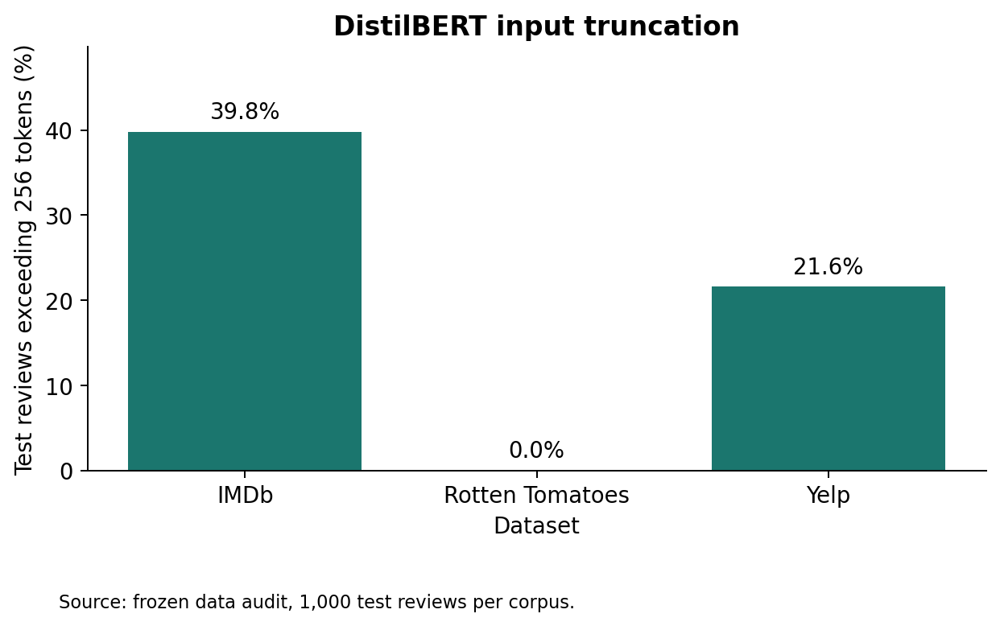
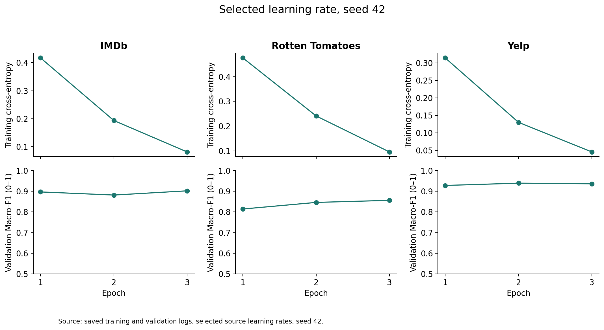
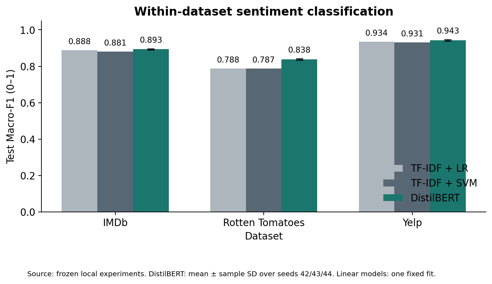
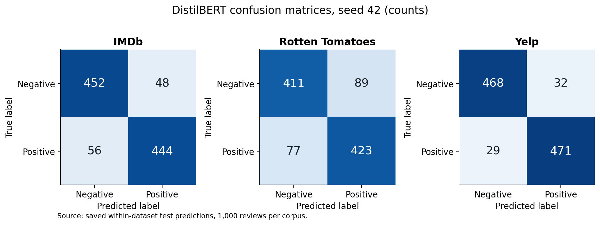
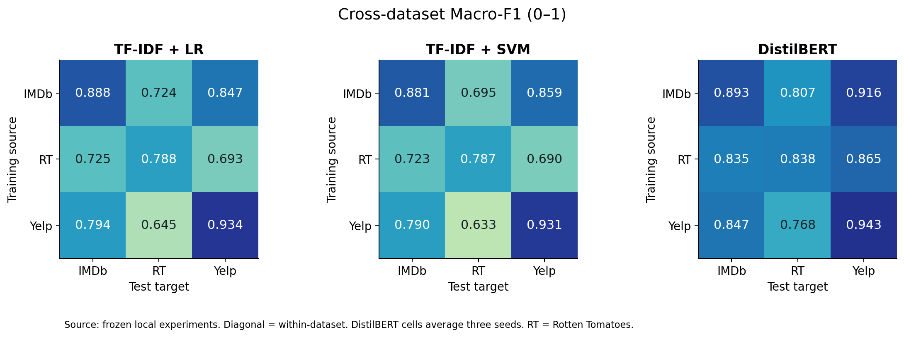
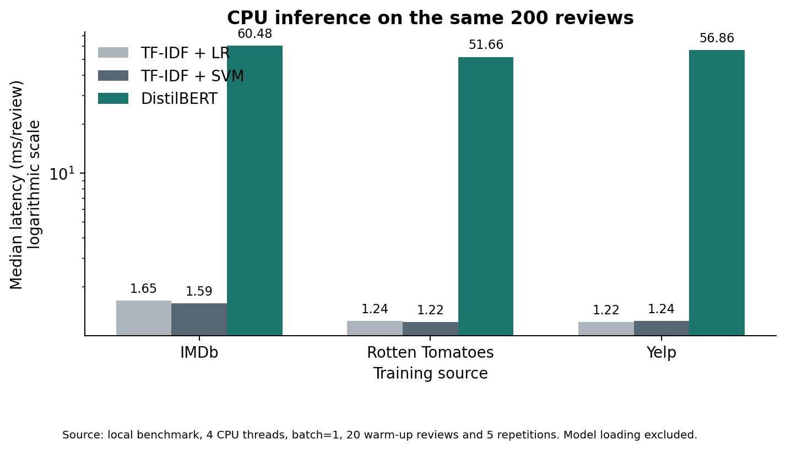

# Cross-Dataset Sentiment Classification

## Abstract

We compare TF-IDF Logistic Regression, TF-IDF Linear SVM and fine-tuned DistilBERT on three English review datasets under fixed labeled-data budgets. Each dataset has a separate source model. We select hyperparameters and checkpoints using source validation labels, then freeze all final artifacts before evaluating within-dataset and cross-dataset test performance. The equal-weight mean of the three within-dataset Macro-F1 values is: TF-IDF + LR 0.8700; TF-IDF + SVM 0.8663; DistilBERT 0.8914. These figures describe this sampled protocol, not full-dataset benchmark replication. Accuracy, transfer matrices and CPU latency provide additional evidence about practical trade-offs.

## 1. Problem and experimental questions

The application helps a reader classify English movie or business reviews as positive or negative. We ask whether contextual pretraining improves classification over strong sparse baselines, how directly transferred models behave on another review corpus, and what inference and training costs accompany any gains. We do not propose a new architecture. DistilBERT has external pretraining, so this comparison does not isolate architecture alone.

## 2. Data and leakage controls

| Dataset | Train | Validation | Test | Test truncated at 256 tokens |
|---|---|---|---|---|
| IMDb | 6000 | 1000 | 1000 | 39.8% |
| Rotten Tomatoes | 6000 | 1000 | 1000 | 0.0% |
| Yelp | 6000 | 1000 | 1000 | 21.6% |

All sampled splits are class-balanced. IMDb and Yelp validation examples come from their official training split. Rotten Tomatoes retains its official validation split. All test examples come from official test splits. Random sampling uses seed 2026. Each run uses exactly the same frozen sample IDs.

We normalize HTML and whitespace, preserve negation and punctuation, and hash case-folded normalized text. Test examples take precedence over official validation and training rows during global exact deduplication. Conflicting duplicate labels are removed. The audit processes 658,662 original rows and retains 658,166 eligible unique rows before sampling. The final manifest contains no repeated normalized text hashes or sample IDs. A deterministic containment probe found 0 exact substring matches in 100 sampled short snippets of at least 50 characters. This is a limited probe, not proof that semantic near-duplicates are absent.

IMDb contains long movie reviews, Rotten Tomatoes contains short movie-review snippets, and Yelp contains business/service reviews. They differ in genre, length, label construction and difficulty. IMDb to Rotten Tomatoes is a change within the movie-review domain. Only comparisons involving Yelp include a broader domain change. Dataset versions and asset hashes appear in `assets.lock.json`; individual sample IDs and split hashes appear in `data/manifest.csv` and `data/audit.json`.

## 3. Methods and model selection

The two sparse models use a TF-IDF pipeline fitted only on source training text. Both search C in {0.1, 1, 10} and word n-gram ranges {(1,1), (1,2)} with at most 30,000 features, min_df=2 and sublinear term frequency. They each receive six configurations per dataset. The first configuration in fixed order breaks exact validation ties.

DistilBERT starts from the generic `distilbert/distilbert-base-uncased` checkpoint, not a sentiment-fine-tuned model. We add a randomly initialized two-class head and fine-tune the encoder using AdamW, effective batch size 16, weight decay 0.01, 10% warm-up and maximum input length 256. For each source, seed42 compares learning rates 2e-5 and 5e-5 for three epochs, retaining the best validation Macro-F1 epoch. The selected learning rate then trains seeds43 and44. Dynamic padding rounds to a multiple of eight. Training uses mixed precision on the available GPU; evaluation uses full precision. Seeds are fixed and deterministic algorithms are requested in warning mode. This run did not configure the CuBLAS deterministic-workspace environment variable, and PyTorch emitted reproducibility warnings retained in `run.log`. Exact GPU reruns are therefore not guaranteed, even on the same setup; the three-seed variation must not be read as a bitwise reproducibility guarantee.

| Source | Model | TF-IDF n-gram | C | DistilBERT LR / selected epoch |
|---|---|---|---|---|
| IMDb | TF-IDF + LR | [1, 2] | 10.0 | — |
| IMDb | TF-IDF + SVM | [1, 2] | 0.1 | — |
| IMDb | DistilBERT | — | — | 5e-05, epoch 3 (seed42) |
| Rotten Tomatoes | TF-IDF + LR | [1, 2] | 10.0 | — |
| Rotten Tomatoes | TF-IDF + SVM | [1, 2] | 1.0 | — |
| Rotten Tomatoes | DistilBERT | — | — | 5e-05, epoch 3 (seed42) |
| Yelp | TF-IDF + LR | [1, 2] | 10.0 | — |
| Yelp | TF-IDF + SVM | [1, 2] | 1.0 | — |
| Yelp | DistilBERT | — | — | 5e-05, epoch 2 (seed42) |

There are 36 sparse candidate fits and 12 DistilBERT training runs, of which nine DistilBERT checkpoints enter the final results. The fifteen final model artifacts and their SHA256 values are recorded in `results/protocol.freeze.json`. The optional training-size experiment was excluded before testing. Neither target labels nor test metrics select learning rates, epochs or demonstration checkpoints. The demonstration uses seed42 consistently.

## 4. Within-dataset test results

| Dataset | Model | Macro-F1 | Accuracy | Training runs |
|---|---|---|---|---|
| IMDb | TF-IDF + LR | 0.8880 | 0.8880 | 1 |
| IMDb | TF-IDF + SVM | 0.8810 | 0.8810 | 1 |
| IMDb | DistilBERT | 0.8933 ± 0.0031 | 0.8933 | 3 |
| Rotten Tomatoes | TF-IDF + LR | 0.7880 | 0.7880 | 1 |
| Rotten Tomatoes | TF-IDF + SVM | 0.7870 | 0.7870 | 1 |
| Rotten Tomatoes | DistilBERT | 0.8379 ± 0.0046 | 0.8380 | 3 |
| Yelp | TF-IDF + LR | 0.9340 | 0.9340 | 1 |
| Yelp | TF-IDF + SVM | 0.9310 | 0.9310 | 1 |
| Yelp | DistilBERT | 0.9430 ± 0.0036 | 0.9430 | 3 |

DistilBERT entries give the mean and sample standard deviation over three training seeds on a fixed test sample. Traditional classifiers have a fixed fit and no artificial three-run error bar. Training standard deviation does not measure test-sample uncertainty. For a paired comparison, we preselect SVM and DistilBERT seed42 and resample the same test IDs within each class 1,000 times.

| Dataset | DistilBERT seed42 minus SVM | 95% paired bootstrap interval |
|---|---|---|
| IMDb | +0.0150 | [-0.0060, +0.0400] |
| Rotten Tomatoes | +0.0470 | [+0.0180, +0.0779] |
| Yelp | +0.0080 | [-0.0110, +0.0251] |

The intervals condition on these two trained models and use the percentile method. They do not integrate training randomness, correct for multiple comparisons or establish a causal effect of architecture.

In the preselected seed42 comparison, the interval lies above zero for Rotten Tomatoes. It spans zero for IMDb, Yelp. Higher point estimates therefore provide stronger evidence on the short movie-review corpus than on the other two sampled corpora; they do not justify a universal claim that the Transformer wins reliably in every setting.

## 5. Cross-dataset transfer

Each row is the training source and each column the test target. We apply the saved source tokenizer/vectorizer and model directly, with no target-label adaptation or calibration. The diagonal repeats the within-dataset experiment; each off-diagonal cell tests direct transfer. DistilBERT cells average seeds42/43/44. Full per-seed metrics, class reports and confusion matrices are in `results/evaluation.json`; all 45,000 individual predictions are in `results/predictions.csv`.

Cross-dataset differences combine vocabulary, sentiment expression, document length and corpus difficulty. A source-diagonal minus target-cell difference is descriptive and must not be attributed purely to domain shift. No target-training-data adaptation experiment is included.

For example, the IMDb-trained DistilBERT averages 0.9157 on Yelp but 0.8066 on Rotten Tomatoes. Sharing a movie-review domain does not guarantee higher performance in this protocol. This observation is consistent with several explanations, including corpus difficulty and text style, which this experiment does not isolate causally.

## 6. Training and deployment costs

Training GPU: NVIDIA GeForce RTX 4090 Laptop GPU. CPU: . Inference measurements use the same CPU and 4 threads for every model. All nine representative source-model combinations process the same fixed 200 mixed-source test texts at batch size1, with 20 warm-up examples and five repetitions. Timing includes cleaning, tokenization/vectorization and model inference, but excludes loading and downloading. The median and p95 are empirical timings, not serving-load throughput guarantees.

| Source | Model | Selected fit (s) | LR/C search (s) | Model (MiB) | CPU median (ms) | CPU p95 (ms) |
|---|---|---|---|---|---|---|
| IMDb | TF-IDF + LR | 2.7 | 11.7 | 1.22 | 1.65 | 3.57 |
| IMDb | TF-IDF + SVM | 2.5 | 11.1 | 1.22 | 1.59 | 2.73 |
| IMDb | DistilBERT | 112.0 | 205.3 | 256.33 | 60.48 | 130.37 |
| Rotten Tomatoes | TF-IDF + LR | 0.2 | 1.3 | 0.72 | 1.24 | 2.15 |
| Rotten Tomatoes | TF-IDF + SVM | 0.2 | 1.4 | 0.72 | 1.22 | 2.06 |
| Rotten Tomatoes | DistilBERT | 56.9 | 120.6 | 256.33 | 51.66 | 111.50 |
| Yelp | TF-IDF + LR | 1.4 | 6.3 | 1.22 | 1.22 | 2.14 |
| Yelp | TF-IDF + SVM | 1.4 | 6.6 | 1.22 | 1.24 | 2.25 |
| Yelp | DistilBERT | 120.5 | 241.8 | 256.33 | 56.86 | 118.75 |

For sparse models, selected fit time includes TF-IDF fitting; the search time includes all six candidates and their validation predictions. For DistilBERT, selected fit is seed42 training, validation and best-checkpoint saving; search sums the two seed42 learning-rate runs. Extra seeds43/44 are additional research cost and remain recorded separately in model metadata. Tokenization and I/O boundaries differ between these training implementations, so the fit columns are operational measurements rather than hardware-normalized efficiency claims. Both training device and preprocessing times are recorded in metadata. GPU peak allocated memory measures live PyTorch tensors, not total GPU or process memory. This implementation does not measure peak CPU RAM, which is a deviation from the original plan.

## 7. Error analysis and review status

The reproducible error queue contains 60 samples, at most ten negative and ten positive examples per dataset, drawn from cases where at least one same-source model errs. DistilBERT uses seed42 for this queue. `results/error_review.csv` retains the full text, gold label and all model predictions. It deliberately leaves human categories, explanations, reviewers and signatures unfilled. Currently 0 rows have the status `human_reviewed`. The queue is stratified for inspection and cannot estimate population error-category frequencies.

An assistant-generated qualitative draft may be supplied separately, clearly identified as a draft. Team members must verify the labels and explanations and record genuine reviewer names. They must not claim that this draft represents two independent human reviewers. Test-error inspection follows model freezing and does not feed another round of model selection.

## 8. Limitations and reproducibility

The three test subsets have 1,000 examples each and do not represent all review settings. We balance the classes artificially, so deployment priors can differ. Binary labels force neutral or mixed opinions into a positive/negative decision. Long reviews lose tokens beyond the first256 for DistilBERT, whereas TF-IDF receives the full cleaned text. The truncation audit makes this resource choice explicit. Near-duplicates, common movies/authors and unknown pretraining overlap remain possible.

Only three models and a small tuning budget are included. Unequal external pretraining and different search spaces limit architectural conclusions. Frozen protocol files, raw per-example outputs and environment versions allow the reported numbers to be independently checked. Source data and pretrained assets remain external downloads in the compact submission archive. Model weights and prepared text remain in the local project folder.

Reproduce in order: `python download_assets.py`, `python pipeline.py all`, `python make_report.py`, `python -m unittest -v test_project`. Already completed stages reuse recorded artifacts. A changed configuration requires a fresh project copy, not overwritten test history. Run `python -m streamlit run app.py` for the demonstration.

## 9. Submission status

Code, model artifacts, results and report form the computational deliverable. A slide deck and a timed narration script can support the required presentation. The course forbids generated voice. Actual team members must record the presentation, verify personal contributions, sign the reflection and use the course's exact GAI declaration template. Peer evaluation is an individual action on NTULearn. This report does not fabricate those actions or claim the project has been submitted.

## References

1. Maas et al. (2011). Learning Word Vectors for Sentiment Analysis. [ACL paper](https://aclanthology.org/P11-1015/). [IMDb dataset card](https://huggingface.co/datasets/stanfordnlp/imdb).
2. Pang and Lee (2005). Seeing stars: Exploiting class relationships for sentiment categorization with respect to rating scales. [Original data release](https://www.cs.cornell.edu/people/pabo/movie-review-data/). [Versioned-format dataset card](https://huggingface.co/datasets/cornell-movie-review-data/rotten_tomatoes).
3. Zhang, Zhao and LeCun (2015). Character-level Convolutional Networks for Text Classification. [Paper](https://arxiv.org/abs/1509.01626). [Yelp Polarity dataset card](https://huggingface.co/datasets/fancyzhx/yelp_polarity).
4. Sanh et al. (2019/2020). DistilBERT, a distilled version of BERT: smaller, faster, cheaper and lighter. [Paper](https://arxiv.org/abs/1910.01108). [Base model card](https://huggingface.co/distilbert/distilbert-base-uncased).
5. Hugging Face. [Text classification guide](https://huggingface.co/docs/transformers/tasks/sequence_classification).
6. scikit-learn. [TF-IDF](https://scikit-learn.org/stable/modules/generated/sklearn.feature_extraction.text.TfidfVectorizer.html) and [LinearSVC](https://scikit-learn.org/stable/modules/generated/sklearn.svm.LinearSVC.html) documentation.
