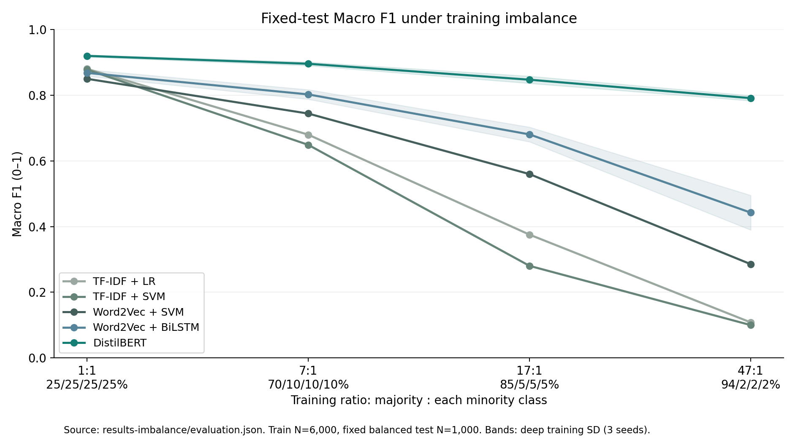
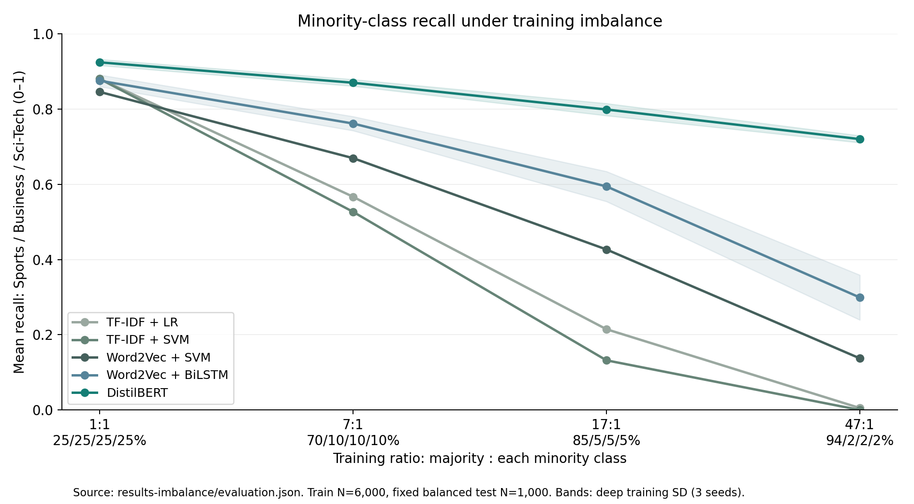

# Traditional NLP and deep learning for text classification

## Research question

When do traditional features with linear classifiers offer sufficient text classification performance, when does a pretrained Transformer provide a larger advantage, and how does training class imbalance change each model's behavior? The project separates predictive quality, inference cost and robustness under shifted training priors.

## Methods and common controls

Traditional methods are TF-IDF + Logistic Regression, TF-IDF + Linear SVM and local Word2Vec mean features + Linear SVM. Deep methods are Word2Vec-initialized BiLSTM and fine-tuned generic DistilBERT with a new classification head. DistilBERT is a Transformer in the BERT family. The experiment does not include every method listed as an option in the assignment. CRF models structured output sequences and does not match the document/pair labels here.

Each conventional task uses 6,000 training, 1,000 validation and 1,000 test texts. MultiNLI uses 6,000 training pairs, 999 source-validation pairs and 999 evaluation pairs for each genre condition. Model selection uses validation Macro F1 only. Deep results average seeds 42/43/44. Traditional methods use fixed fits. Feature extraction fits training text only. Saved protocols, sample manifests and checkpoint hashes support reproducibility. DistilBERT's external pretraining differs from training local word embeddings and limits attribution to architecture alone.

## Experiment 1: conventional tasks and inference cost

Macro F1, deep values averaged over three seeds:

| Task | TF-IDF + LR | TF-IDF + SVM | Word2Vec + SVM | Word2Vec + BiLSTM | DistilBERT |
| --- | --- | --- | --- | --- | --- |
| imdb | 0.8880 | 0.8810 | 0.8610 | 0.8371 | 0.8933 |
| rotten_tomatoes | 0.7880 | 0.7870 | 0.6440 | 0.7525 | 0.8379 |
| yelp | 0.9340 | 0.9310 | 0.8880 | 0.8948 | 0.9430 |
| ag_news | 0.8800 | 0.8776 | 0.8497 | 0.8678 | 0.9195 |

The strongest traditional baseline is close to DistilBERT on IMDb and Yelp, with gaps below one percentage point. Rotten Tomatoes and AG News show larger gaps, around four to five points. Thus, **similar performance is task-dependent**, rather than a property of all conventional text classification. A BiLSTM does not automatically beat sparse features.

The following earlier CPU benchmark uses IMDb-trained checkpoints on the same 200 mixed review texts, batch1, four CPU threads, five repeats. Cleaning, feature conversion/tokenization and forward prediction are included. Loading is excluded. Values are milliseconds per text. These are common-workload timings from the original experiment, not new measurements concurrent with robustness training.

| model | median_ms | p95_ms |
| --- | --- | --- |
| logistic_regression | 1.6489 | 3.5742 |
| linear_svm | 1.5862 | 2.7322 |
| distilbert | 60.4796 | 130.3669 |
| word2vec_svm | 0.9078 | 1.5487 |
| bilstm | 14.1369 | 44.9089 |

Traditional classifiers offer substantially lower latency on this workload. Hardware, input lengths, batching and implementations affect the tradeoff. The full report retains p95 values, model sizes and selection details. News-trained models were also timed on the same review workload, so those values should not be described as news production latency.

## Experiment 2: MultiNLI sentence-pair semantics

Three labels describe entailment, neutral and contradiction. Pair-aware traditional features concatenate premise, hypothesis, absolute difference and elementwise product; a shared BiLSTM uses corresponding interactions. DistilBERT jointly encodes both sentences. Normalized premise groups stay disjoint across partitions. Reserved evaluation pools come from official validation_matched and validation_mismatched, not the hidden test leaderboard.

| Evaluation | TF-IDF + LR | TF-IDF + SVM | Word2Vec + SVM | Word2Vec + BiLSTM | DistilBERT |
| --- | --- | --- | --- | --- | --- |
| mnli_matched | 0.5021 | 0.4990 | 0.4784 | 0.4865 | 0.6580 |
| mnli_mismatched | 0.5228 | 0.5111 | 0.4705 | 0.5265 | 0.6721 |

DistilBERT exceeds paired SVM by about 16 Macro-F1 points in both sampled genre conditions. A predeclared seed42 premise-cluster bootstrap gives positive 95% intervals for both differences; see `hard-benchmark-report.md` for exact contrasts and uncertainty limits. Hypothesis-only SVM obtains above-chance Accuracy, so annotation cues remain relevant. These results support the advantage of this pretrained Transformer under this budget, without proving universal deep-learning superiority or pure logical reasoning. Mismatched performance is slightly higher here; genre shift does not guarantee a decrease on every sampled evaluation.

## Experiment 3: fixed-budget class imbalance

Keep the four-class AG News training total at 6,000, but increase World support from 25% to 70%, 85% and 94%. Minority supports decrease from 1,500 each to 600, 300 and 120. Keep the same balanced validation/test sets and freeze the balanced-validation-selected hyperparameters. Refit features only on the corresponding condition. The severe comparison follows; positive decline means balanced minus severe.

| Model | Severe Macro F1 | F1 SD | F1 drop (pp) | Drop SD (pp) | Minority Recall | Recall drop (pp) | MCC |
| --- | --- | --- | --- | --- | --- | --- | --- |
| TF-IDF + LR | 0.1082 | — | 77.1717 | — | 0.0053 | 87.4667 | 0.0517 |
| TF-IDF + SVM | 0.1000 | — | 77.7637 | — | 0.0000 | 88.0000 | 0.0000 |
| Word2Vec + SVM | 0.2856 | — | 56.4126 | — | 0.1373 | 70.8000 | 0.2460 |
| Word2Vec + BiLSTM | 0.4424 | 0.0527 | 42.5380 | 4.9361 | 0.2991 | 57.6000 | 0.3515 |
| DistilBERT | 0.7910 | 0.0078 | 12.8587 | 0.9616 | 0.7200 | 20.4000 | 0.7354 |

The largest Macro-F1 deterioration is TF-IDF + SVM (77.76 points). The highest absolute severe-condition Macro F1 is DistilBERT (0.7910). These are different comparisons. Minority scarcity can weaken feature estimation and class-boundary learning, while changed priors encourage majority predictions. The experiment does not isolate these mechanisms or architecture from pretraining resources. Depth alone does not determine robustness.

The experiment compares deterioration relative to each model's own balanced baseline as well as absolute severe-condition quality. Both matter: a small drop from a weaker baseline does not establish the strongest classifier. The minority metrics and per-class confusion reveal failures that aggregate Accuracy can hide under an imbalanced deployment prior.

Predeclared inverse-frequency class weights at severe imbalance:

| Model | Class-weighted model Macro F1 | F1 gain (pp) | Minority Recall | Recall gain (pp) |
| --- | --- | --- | --- | --- |
| DistilBERT | 0.8193 | 2.8291 | 0.7684 | 4.8444 |
| TF-IDF + SVM | 0.4000 | 30.0038 | 0.2413 | 24.1333 |

See `imbalance-report.md` for full protocol, per-class scores, three-seed SD, conditional bootstrap intervals and changed-prior Accuracy simulation. The simulation is not an additional observed test set. One majority-class orientation and one subset realization limit generalization. Minority scarcity and changed priors remain combined even at fixed training N.

## Final interpretation

1. Conventional tasks can favor a low-latency traditional classifier when its predictive performance is sufficiently close. IMDb/Yelp support this practical tradeoff; other corpora show larger quality gains from DistilBERT.
2. Complex sentence-pair semantics reveal a larger advantage for the tested pretrained Transformer, while the tested BiLSTM does not show the same improvement.
3. Training imbalance is a separate robustness dimension. Report Macro F1 deterioration together with minority Recall and class-specific errors, then assess a predeclared mitigation. Do not infer a universal robustness ordering from a single corpus and majority class.

All empirical statements concern the local fixed-budget experiments. The English Streamlit application provides prediction, multi-metric comparisons, MultiNLI pair inputs and an imbalance robustness tab. Prediction demos retain balanced checkpoints. Previous reports remain historical detailed records; this document is the integrated reading order.

## Evidence and references

- Local detailed reports: `classification-report-v2.md`, `hard-benchmark-report.md`, `imbalance-report.md`.
- Exact model predictions and metadata: `results-v2`, `results-hard`, `results-imbalance`; source revisions: `assets.lock.json`.
- [Williams et al. (2018), MultiNLI](https://aclanthology.org/N18-1101/).
- [Gururangan et al. (2018), annotation artifacts](https://aclanthology.org/N18-2017/).
- [DistilBERT](https://arxiv.org/abs/1910.01108).
- [scikit-learn metrics](https://scikit-learn.org/stable/modules/model_evaluation.html), [class weights](https://scikit-learn.org/stable/modules/generated/sklearn.utils.class_weight.compute_class_weight.html).

Member contributions, personal signatures and a real narrated video remain for actual members, as deferred by the user. This project does not claim those human activities are complete.
