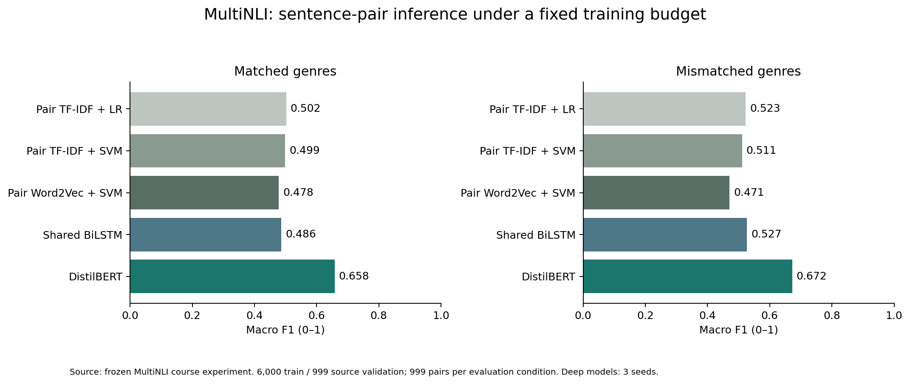
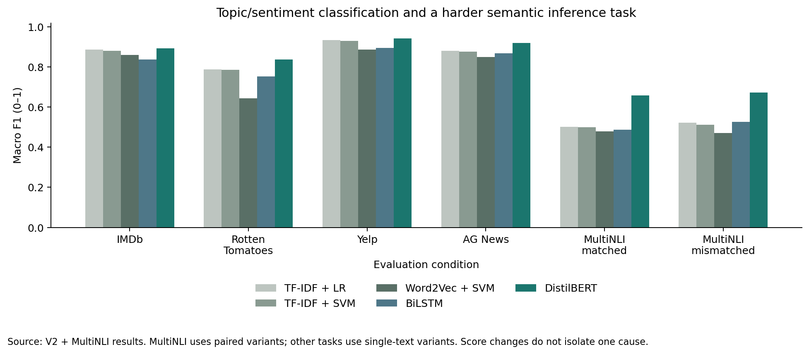
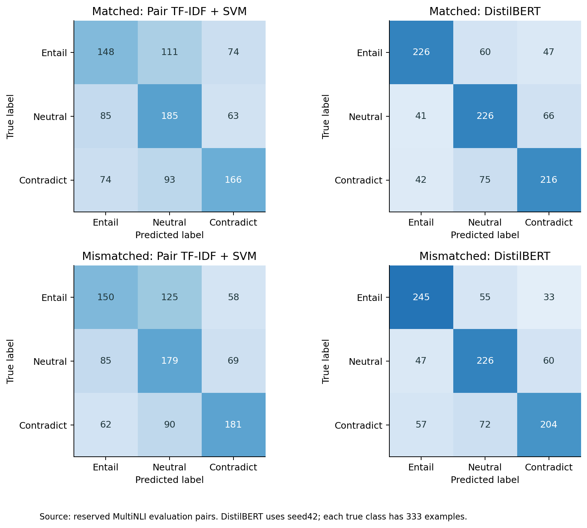

# MultiNLI: a harder benchmark for sentence-pair semantics

## Why this benchmark adds difficulty

The original tasks classify the sentiment or topic of one text. MultiNLI asks whether a hypothesis follows from, contradicts, or is neither established nor contradicted by a premise. Its matched and mismatched genre settings add an explicit generalization comparison. The original paper describes a broad-coverage inference challenge with diverse spoken and written genres; this is a different semantic task, not simply an increase in class count. We selected it before observing its final scores and did not replace it based on the resulting model gap. [Williams et al., 2018](https://aclanthology.org/N18-1101/)

## Fixed protocol and honest benchmark scope

We use 6,000 training pairs, 999 validation pairs sampled from the official training pool, and 999 pairs each from `validation_matched` and `validation_mismatched`, balanced at 333 examples per evaluation class. These reserved official validation samples serve as evaluation pools for the course experiment. They are **not official hidden-test leaderboard results**, full-data replication or a new state of the art. Label IDs follow the source data: 0 entailment, 1 neutral, 2 contradiction. [Dataset card](https://huggingface.co/datasets/nyu-mll/multi_nli)

Training-only source validation selects hyperparameters and epochs. Before final evaluation, `results-hard/protocol.freeze.json` records nine main-model checkpoints and one hypothesis-only diagnostic. The original V1/V2 records remain unchanged. Matched/mismatched samples were fixed in advance, not chosen for favorable results.

### Leakage and genre controls

Exact pairs with contradictory labels are removed. Normalized premises are grouped across partitions, so a premise cannot appear in both train and validation/evaluation even with a different hypothesis. Official evaluation pools take precedence over training during grouping. Genre, pairID and parsing metadata are never model inputs. `data-hard/audit.json` records raw counts, genre distributions, group counts, hashes and truncation. Grouping does not rule out paraphrase or pretraining overlap.

| Split | Pairs | Unique premises | Median paired subwords | Truncated at 256 |
|---|---|---|---|---|
| train | 6000 | 5913 | 37.0 | 0.02% |
| validation | 999 | 996 | 37.0 | 0.00% |
| matched | 999 | 904 | 35.0 | 0.00% |
| mismatched | 999 | 906 | 38.0 | 0.00% |

## Comparable pair-aware models

The five families remain TF-IDF+LR, TF-IDF+SVM, Word2Vec+SVM, BiLSTM and DistilBERT. Traditional methods receive both sentences and interaction features: concatenate premise representation, hypothesis representation, their absolute difference and elementwise product. TF-IDF fits a shared training-only vocabulary and searches two n-gram choices and C in 0.1/1/10. Word2Vec uses 100D locally trained vectors; its mean-vector features use StandardScaler and the same C choices. These are stronger pair baselines than simple unmarked text concatenation.

The shared BiLSTM uses one encoder for both sentences, 100D trainable Word2Vec initialization and 64 units in each direction. It concatenates the two sentence states, absolute difference and product, followed by a small classification head. Seed42 compares learning rates 0.001/0.003 over five epochs, then the selected learning rate runs seeds43/44. DistilBERT jointly tokenizes premise/hypothesis with separator tokens, compares 2e-5/5e-5 over three epochs, then adds seeds43/44. It uses the generic pretrained base, not an NLI-fine-tuned checkpoint.

BiLSTM allows 256 word tokens **per sentence**; DistilBERT allows 256 subwords **for the combined pair**, with longest-first truncation. Sparse and mean-vector models read full cleaned sentences. These are different budgets, and external pretraining differs. Training is supervised from the same 6,000 labeled pairs but this is not a causal isolation of architecture.

## Matched and mismatched results

| Condition | Model | Accuracy | Macro Precision | Macro Recall | Macro F1 | Weighted F1 |
|---|---|---|---|---|---|---|
| matched | Pair TF-IDF + LR | 0.5015 | 0.5068 | 0.5015 | 0.5021 | 0.5021 |
| matched | Pair TF-IDF + SVM | 0.4995 | 0.5018 | 0.4995 | 0.4990 | 0.4990 |
| matched | Pair Word2Vec + SVM | 0.4795 | 0.4822 | 0.4795 | 0.4784 | 0.4784 |
| matched | Shared BiLSTM | 0.4885 | 0.5006 | 0.4885 | 0.4865 | 0.4865 |
| matched | DistilBERT | 0.6577 | 0.6612 | 0.6577 | 0.6580 | 0.6580 |
| mismatched | Pair TF-IDF + LR | 0.5225 | 0.5261 | 0.5225 | 0.5228 | 0.5228 |
| mismatched | Pair TF-IDF + SVM | 0.5105 | 0.5157 | 0.5105 | 0.5111 | 0.5111 |
| mismatched | Pair Word2Vec + SVM | 0.4715 | 0.4745 | 0.4715 | 0.4705 | 0.4705 |
| mismatched | Shared BiLSTM | 0.5279 | 0.5419 | 0.5279 | 0.5265 | 0.5265 |
| mismatched | DistilBERT | 0.6723 | 0.6744 | 0.6723 | 0.6721 | 0.6721 |

- Matched: pair SVM Macro F1=0.4990; DistilBERT=0.6580; mean-score difference=+15.90 percentage points. This mean difference is distinct from the seed42 bootstrap contrast below.
- Mismatched: pair SVM Macro F1=0.5111; DistilBERT=0.6721; mean-score difference=+16.10 percentage points. This mean difference is distinct from the seed42 bootstrap contrast below.

Deep values average three seeds; traditional fits are fixed. Full per-seed outputs, SD, MCC, Macro/Micro/Weighted P/R/F1 and class metrics are saved. Balanced supports make Macro and Weighted coincide; single-label Micro P/R/F1 equal Accuracy. These are not independent evidence. Uniform random guessing has expected Accuracy 1/3, not a guaranteed observed F1.

### Conditional uncertainty

| Condition | DistilBERT seed42 minus pair SVM, Delta Macro F1 | 95% premise-cluster interval |
|---|---|---|
| matched | +0.1703 | [+0.1377, +0.2092] |
| mismatched | +0.1639 | [+0.1303, +0.1962] |

We resample normalized premise groups 1,000 times, preserving dependent hypotheses sharing a premise. The percentile intervals condition on two fixed models and exclude training uncertainty. They do not test every model pair or correct multiple comparisons. A matched-to-mismatched difference also reflects different samples and genre difficulty, so it is not an isolated causal domain-shift estimate. A higher mismatched score is possible and must be reported as measured.

### Hypothesis-only diagnostic

| Condition | Hypothesis-only Accuracy | Hypothesis-only Macro F1 | Pair SVM Macro F1 |
|---|---|---|---|
| matched | 0.4404 | 0.4399 | 0.4990 |
| mismatched | 0.4555 | 0.4563 | 0.5111 |

A fixed TF-IDF SVM (C=1, unigram+bigram) is trained only on training hypotheses and does not see premises. It is a diagnostic, not a sixth family selected for the headline comparison. Scores above chance can reveal that premise-free surface cues carry predictive information; they do not establish that any particular artifact caused an individual decision. Prior work motivates this check. [Gururangan et al., 2018](https://aclanthology.org/N18-2017/)

## What the harder task shows

The inference task has a much lower performance range than the earlier topic/sentiment samples in this particular protocol. That observation supports including it as a harder empirical comparison. It does not prove that semantic reasoning alone causes the gap: the label definitions, class count, data distribution and paired input design differ. A larger Transformer-versus-SVM gap would support a task-dependent advantage under this budget, not a universal claim that deep learning always wins. A small or reversed gap would also be a valid result. The benchmark and search space were fixed before evaluation.

## Per-class behavior and computational cost

Per-class Precision/Recall/F1 and support are in `results-hard/class_metrics.csv` and the English GUI, along with count or normalized 3x3 confusion matrices. A 24-case sampled error-review queue retains both sentences, genre, gold label and model predictions; its explanations and human-review status remain unfilled.

| Model | CPU median (ms/pair) | CPU p95 (ms/pair) |
|---|---|---|
| Pair TF-IDF + LR | 3.08 | 4.12 |
| Pair TF-IDF + SVM | 2.48 | 3.36 |
| Pair Word2Vec + SVM | 0.82 | 1.32 |
| Shared BiLSTM | 6.13 | 11.08 |
| DistilBERT | 34.49 | 61.32 |

All models process the same 200 matched pairs with four CPU threads, batch 1, 20 warm-ups and five repetitions. Timing includes preprocessing and forward computation but excludes loading/download. This differs from the earlier review-text workload; do not compare those timings as though the inputs were identical.

## Reproduce and demonstrate

Run `python download_assets.py`, `python hard_benchmark.py all`, `python make_report_hard.py`, then `python -m unittest -v test_project test_extension test_hard`. The English GUI adds Natural language inference, separate premise/hypothesis fields, matched/mismatched evaluation selection, all existing metrics and the premise-free diagnostic. Demonstration models consistently use seed42.

This report supplements `classification-report-v2.md`. Member information remains deferred. Real narration, signatures and official submission are outside the computational experiment.
