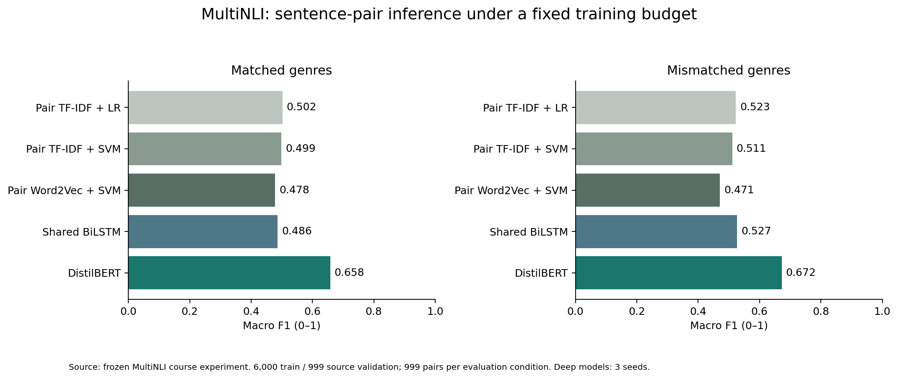

# MultiNLI 更难语义任务结果

新增前提／假设双输入，预测蕴含、中立、矛盾。分别评估 matched 与 mismatched 体裁，传统模型也使用成对交互特征。

| 条件 | 模型 | Accuracy | Macro P | Macro R | Macro F1 | Weighted F1 |
|---|---|---|---|---|---|---|
| matched | Pair TF-IDF + LR | 0.5015 | 0.5068 | 0.5015 | 0.5021 | 0.5021 |
| matched | Pair TF-IDF + SVM | 0.4995 | 0.5018 | 0.4995 | 0.4990 | 0.4990 |
| matched | Pair Word2Vec + SVM | 0.4795 | 0.4822 | 0.4795 | 0.4784 | 0.4784 |
| matched | Shared BiLSTM | 0.4885 | 0.5006 | 0.4885 | 0.4865 | 0.4865 |
| matched | DistilBERT | 0.6577 | 0.6612 | 0.6577 | 0.6580 | 0.6580 |
| mismatched | Pair TF-IDF + LR | 0.5225 | 0.5261 | 0.5225 | 0.5228 | 0.5228 |
| mismatched | Pair TF-IDF + SVM | 0.5105 | 0.5157 | 0.5105 | 0.5111 | 0.5111 |
| mismatched | Pair Word2Vec + SVM | 0.4715 | 0.4745 | 0.4715 | 0.4705 | 0.4705 |
| mismatched | Shared BiLSTM | 0.5279 | 0.5419 | 0.5279 | 0.5265 | 0.5265 |
| mismatched | DistilBERT | 0.6723 | 0.6744 | 0.6723 | 0.6721 | 0.6721 |

- Matched: pair SVM Macro F1=0.4990; DistilBERT=0.6580; mean-score difference=+15.90 percentage points. This mean difference is distinct from the seed42 bootstrap contrast below.
- Mismatched: pair SVM Macro F1=0.5111; DistilBERT=0.6721; mean-score difference=+16.10 percentage points. This mean difference is distinct from the seed42 bootstrap contrast below.

本实验为固定预算抽样：训练6,000对、验证999对、两种评估条件各999对。评估样本来自官方validation池，并非官方隐藏测试榜单。旧任务与新任务输入和标签不同，分差不能全部归因于某一个因素。完整说明见hard-benchmark-report.md。
