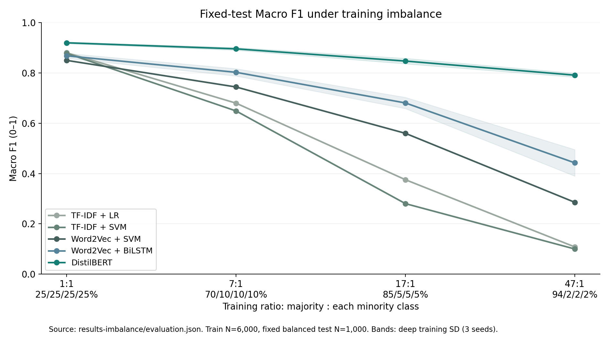
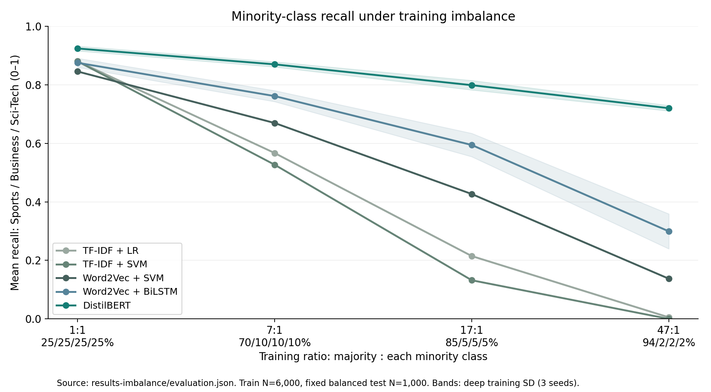
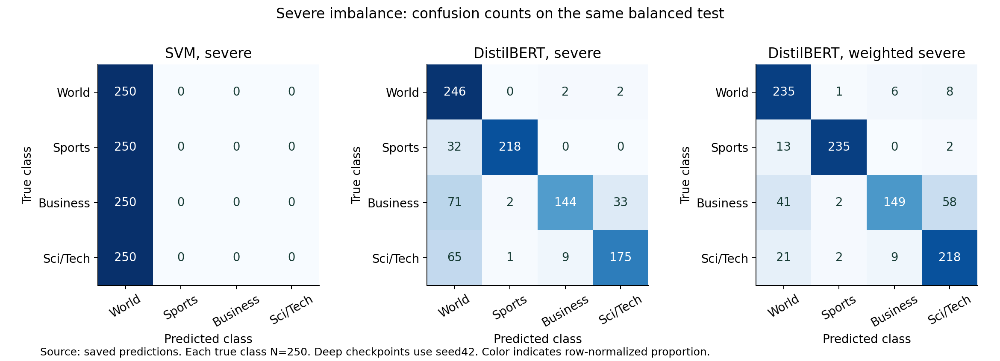

# Controlled class-imbalance robustness experiment

## Question and protocol

How do traditional and deep text classifiers deteriorate when minority labels become scarce, at a fixed total training budget? This is an exploratory extension requested after the original AG News test results were inspected. New ratios, World as the majority class, frozen hyperparameters and severe-only mitigation were specified in `config-imbalance.json` and `results-imbalance/design.freeze.json` before the new training runs.

| Condition | World | Sports | Business | Sci/Tech | Total | Ratio |
| --- | --- | --- | --- | --- | --- | --- |
| balanced | 1500 | 1500 | 1500 | 1500 | 6000 | 1:1 |
| mild | 4200 | 600 | 600 | 600 | 6000 | 7:1 |
| moderate | 5100 | 300 | 300 | 300 | 6000 | 17:1 |
| severe | 5640 | 120 | 120 | 120 | 6000 | 47:1 |

Every condition has **6,000 unique training texts**. Validation and test reuse the exact balanced AG News splits, **1,000 texts each, 250 per class**. The balanced reference reuses the original checkpoints and saved predictions. Increasing World examples come from the eligible official training pool. Minority examples are nested subsets of the balanced training split. No repeated/oversampled texts and no normalized exact-text overlap with validation/test are allowed. Official test texts take precedence during deduplication, so even unsampled official test texts cannot enter training. Only one sampling realization and one majority-class orientation are tested.

Five families: TF-IDF + LR, TF-IDF + SVM, training-only Word2Vec mean + SVM, Word2Vec-initialized BiLSTM and generic pretrained DistilBERT. All classifiers retain hyperparameters chosen on balanced AG News validation. Each new feature extractor fits its own condition's training texts. BiLSTM and DistilBERT each use seeds 42/43/44, the original 5/3 epoch budgets and validation Macro F1 checkpoint selection. The identical subsets across seeds isolate training randomness, not uncertainty in the sampling design. Word vectors use 100 dimensions, SGNS, ten epochs and one worker. DistilBERT benefits from external pretraining, while local word vectors do not.

## Metrics and deterioration

Primary metrics use the fixed balanced test: Macro Precision/Recall/F1, Accuracy, MCC, mean minority Recall/F1 across Sports/Business/Sci-Tech, worst-class Recall and per-class scores. Balanced Accuracy equals Macro Recall here. Because test supports are equal, weighted and macro F1 coincide, and Accuracy equals balanced Accuracy. Reporting both is for clarity, not independent evidence. A positive deterioration equals `100 × (balanced score − condition score)` in percentage points. Negative changes remain visible. Deep summaries average three seeds and show sample training SD.

Severe condition compared with each model's own balanced reference:

| Model | Severe Macro F1 | F1 SD | F1 drop (pp) | Drop SD (pp) | Minority Recall | Recall drop (pp) | MCC |
| --- | --- | --- | --- | --- | --- | --- | --- |
| TF-IDF + LR | 0.1082 | — | 77.1717 | — | 0.0053 | 87.4667 | 0.0517 |
| TF-IDF + SVM | 0.1000 | — | 77.7637 | — | 0.0000 | 88.0000 | 0.0000 |
| Word2Vec + SVM | 0.2856 | — | 56.4126 | — | 0.1373 | 70.8000 | 0.2460 |
| Word2Vec + BiLSTM | 0.4424 | 0.0527 | 42.5380 | 4.9361 | 0.2991 | 57.6000 | 0.3515 |
| DistilBERT | 0.7910 | 0.0078 | 12.8587 | 0.9616 | 0.7200 | 20.4000 | 0.7354 |

The largest Macro-F1 deterioration is TF-IDF + SVM (77.76 points). The highest absolute severe-condition Macro F1 is DistilBERT (0.7910). These are different comparisons. Minority scarcity can weaken feature estimation and class-boundary learning, while changed priors encourage majority predictions. The experiment does not isolate these mechanisms or architecture from pretraining resources. Depth alone does not determine robustness.

Mean per-class Recall at severe imbalance (each true class has 250 test examples):

| Model | World | Sports | Business | Sci/Tech |
| --- | --- | --- | --- | --- |
| TF-IDF + LR | 1.0000 | 0.0000 | 0.0040 | 0.0120 |
| TF-IDF + SVM | 1.0000 | 0.0000 | 0.0000 | 0.0000 |
| Word2Vec + SVM | 1.0000 | 0.1200 | 0.1000 | 0.1920 |
| Word2Vec + BiLSTM | 0.9867 | 0.3333 | 0.3027 | 0.2613 |
| DistilBERT | 0.9880 | 0.8453 | 0.6213 | 0.6933 |

Full condition/metric results: `results-imbalance/comparison.csv`; all 40 run records: `metrics.csv`; all 40,000 predictions: `predictions.csv`; per-class results: `class_metrics.csv`. The 40 records comprise nine reused balanced fits, 27 new unweighted fits and four severe weighted fits. F1 SD is the severe-score training SD; Drop SD pairs the same three training seeds between balanced and severe. Neither is a test confidence interval. Fixed traditional fits have no training SD.

## Predeclared class-weight mitigation

At severe imbalance only, TF-IDF SVM uses `class_weight='balanced'`, and DistilBERT retrains from the generic checkpoint with inverse-frequency cross-entropy weights `N / (4 n_c)`, approximately [0.2660, 12.5, 12.5, 12.5]. Same data, learning rate, epochs and validation criterion. This compares two representative models, without searching weights against test results. Positive gain means weighted minus unweighted severe score.

| Model | Class-weighted model Macro F1 | F1 gain (pp) | Minority Recall | Recall gain (pp) |
| --- | --- | --- | --- | --- |
| DistilBERT | 0.8193 | 2.8291 | 0.7684 | 4.8444 |
| TF-IDF + SVM | 0.4000 | 30.0038 | 0.2413 | 24.1333 |

## Conditional uncertainty

| model | degradation_macro_f1 | ci95_low | ci95_high |
| --- | --- | --- | --- |
| logistic_regression | 0.7717 | 0.7502 | 0.7928 |
| linear_svm | 0.7776 | 0.7583 | 0.7969 |
| word2vec_svm | 0.5641 | 0.5276 | 0.5982 |
| bilstm | 0.3718 | 0.3367 | 0.4076 |
| distilbert | 0.1335 | 0.1102 | 0.1592 |

These are 2,000 paired class-stratified bootstrap replicates on the fixed 1,000 test examples, balanced minus severe. Deep contrasts use seed42 only. Intervals condition on the trained checkpoints and do not cover training randomness, alternative class orientations or subset draws. No multiple-comparison correction. Three-seed SD answers a different uncertainty question.

## Accuracy under a changed deployment prior

The main test remains balanced. A **separate simulated prior-weighted Accuracy** reweights these same predictions by desired training prior / observed test prior. This assumes label shift with unchanged class-conditional text distributions. It is not an additional observed test set. At a 94/2/2/2 prior, an always-World rule has simulated Accuracy 94%, while its fixed balanced-test Accuracy is 25%, Macro F1 is 0.10 and minority Recall is zero. This mathematical diagnostic explains why aggregate Accuracy alone can hide minority failures. Compare observed fixed-test scores separately from this simulation.

## Limits

This experiment measures the joint effect of changed priors and minority scarcity at fixed N. Text composition also changes. Condition-specific features and validation checkpoint selection are part of the pipeline. One corpus, World as majority, a fixed sampling realization and small minority counts limit generalization. Pretraining resources differ across model families. Results cannot establish a universal robustness ordering for traditional ML versus all deep learning. The imbalance experiment introduces no new latency benchmark: architecture and tokenizer are unchanged, and the earlier common-workload CPU measurements remain the latency evidence.

## Sources

- AG News source and immutable revisions: `assets.lock.json`, `data-v2/audit.json`, `data-imbalance/audit.json`.
- [scikit-learn Balanced Accuracy](https://scikit-learn.org/stable/modules/generated/sklearn.metrics.balanced_accuracy_score.html): mean recall across classes.
- [scikit-learn class weights](https://scikit-learn.org/stable/modules/generated/sklearn.utils.class_weight.compute_class_weight.html): inverse-frequency balanced weighting.
- Local package versions and original protocols: README and existing experiment reports. Sources describe definitions; all scores above come from local saved predictions.
