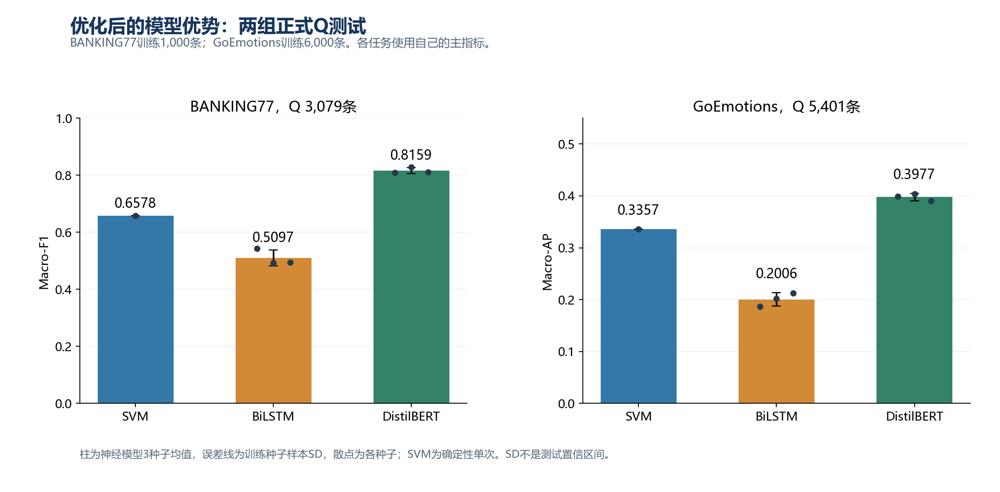
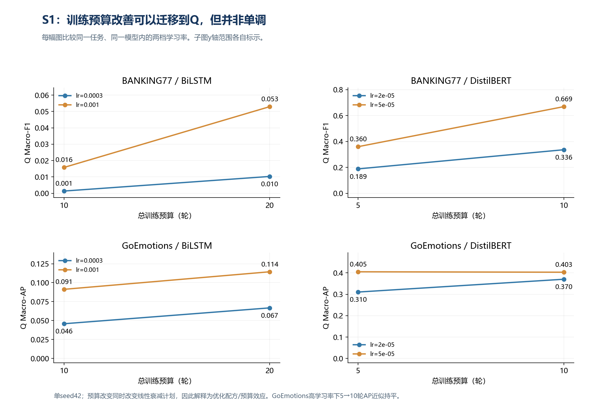
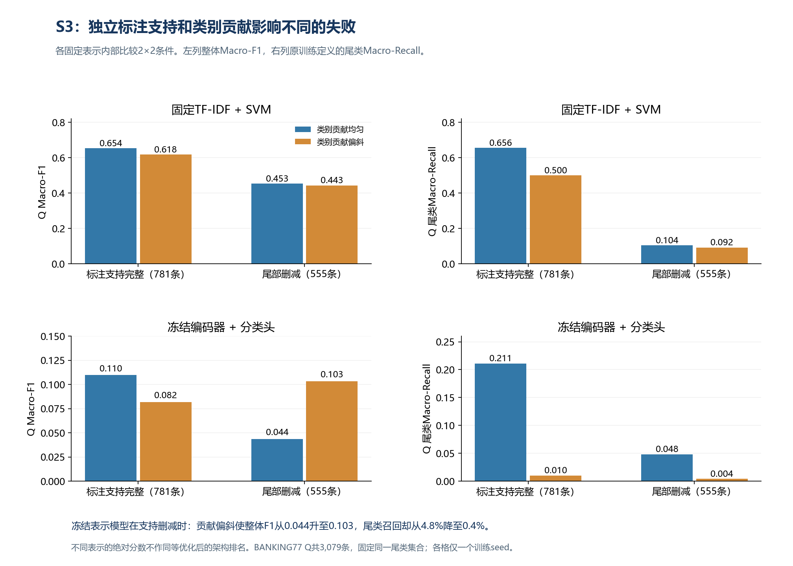

# 文本分类模型能力边界与失败机制：基于现有结果的统一分析

分析日期：2026-11-08（新加坡时间）。本版纳入42个已完成Q评估的固定模型，另结合既有V对照、D错误轨迹和37对词汇干预。

**当前主要结论：模型的优势取决于数据条件、优化配方和预训练表征；尾类失败既受独立标注支持影响，也受训练贡献分配影响。整体分数、逐标签的样本排序与具体错误稳定性需要分别观察。**

本分析从保存的42份逐样本预测重新计算全部指标，核对文件SHA256、Q样本ID、标签、group_id和固定阈值，指标误差小于1e-12。[计算与来源记录](../../research-v3/reports/overnight/analysis-v2/analysis-data.json)。没有启动新训练、推理或Q选参。

[研究主线与六组数据的含义](../../research-v3/RESEARCH.md)逐项说明“观察现象—子问题—对照证据—核心问题答案”。[查看三页Q分析图](../../research-v3/reports/overnight/analysis-v2/Q测试与机制对照分析.pdf)。本版替换旧的执行中状态；[Q完成前的分析原文](../../research-v3/reports/overnight/analysis-v2/results-analysis-before-42Q.md)保留。

## 1. 核心问题与分析路线

### 1.1 承接交接前的研究发现

原项目已比较常规分类、MultiNLI和AG News类别不平衡，发现模型优势具有任务条件性，并留下预训练归因、尾类样本稀缺与类别偏置未分离等问题。当前研究承接这些发现：E1/S1与后续优化检验规模和配方因素，M2分解预训练/适配，S3分离标注支持与类别贡献，S2/S4把总体差异连接到具体错误。[交接前后的连续论证](../../docs/RESEARCH-CONTINUITY.md)按原交接清单核实来源。

这是从性能比较推进到局部机制解释；BANKING77的M2/S4不直接解释原MultiNLI分差，原四线程batch1延迟也不与新八线程批预测均摊耗时直接求加速比。[完整图册](../../research-v3/reports/overnight/complete-atlas-v1/完整研究图册.pdf)以接续图开篇，再展示11张结果图。

### 1.2 当前问题与分析路线

能力边界问题是：在什么任务、数据规模和类别分布下，模型优势出现、消失或反转？失败机制问题是：优化、预训练表征、标注支持和词汇线索分别怎样影响失败？

分析顺序为：基准比较发现现象 → 提出候选解释 → 用匹配对照/干预检验 → 报告效应大小与具体错误 → 回答这两个问题。短预算结果用于发现现象，不能直接充当架构上限。V用于选择与探索，D用于错误观察与干预，Q用于固定检查点的独立评估。

## 2. 现象一：优化后的两组Q测试有一致排序

| 条件 | SVM | BiLSTM（均值±SD） | DistilBERT（均值±SD） |
| --- | --- | --- | --- |
| BANKING77 1k / Q Macro-F1 | 0.6578 | 0.5097 ± 0.0282 | 0.8159 ± 0.0103 |
| GoEmotions 6k / Q Macro-AP | 0.3357 | 0.2006 ± 0.0127 | 0.3977 ± 0.0068 |

BANKING77训练1,000条、Q 3,079条；GoEmotions训练6,000条、Q 5,401条。神经模型为seed42/43/44的均值与样本SD，SVM为确定性单次；训练种子SD不是测试置信区间。所有配方由V选定，Q没有用来重新选模型。

两组条件均为 **DistilBERT > SVM > BiLSTM**，且三个神经种子分别都保持这个相对SVM的方向。DistilBERT相对SVM分别高15.81个Macro-F1百分点和6.20个Macro-AP百分点；BiLSTM分别低14.80和13.50个百分点。

这说明：在这两组已测条件和优化范围内，预训练Transformer的优势稳定出现；同属深度学习的BiLSTM仍低于稀疏线性SVM。不能用一个“深度模型”标签概括二者的能力边界，也不能从这两个点位推出精确的样本量临界值。

## 3. 子问题一：早期低分有多少来自优化配方？

**候选解释：** 神经模型的低分可能部分来自学习率和训练预算设置，而不是数据条件下已达到的能力上限。

**实验：** S1在相同数据、输入和CPU设置下，对BiLSTM做10/20轮、DistilBERT做5/10轮的学习率×预算对照；全部16个固定检查点现已评估Q。

| 数据集/模型 | 学习率 | 较短预算Q | 较长预算Q | 变化（百分点） |
| --- | --- | --- | --- | --- |
| banking77/bilstm | lr=0.0003 | 0.0014 | 0.0103 | +0.89 |
| banking77/bilstm | lr=0.001 | 0.0158 | 0.0529 | +3.71 |
| banking77/distilbert | lr=2e-05 | 0.1886 | 0.3363 | +14.77 |
| banking77/distilbert | lr=5e-05 | 0.3600 | 0.6689 | +30.88 |
| go_emotions/bilstm | lr=0.0003 | 0.0458 | 0.0667 | +2.09 |
| go_emotions/bilstm | lr=0.001 | 0.0912 | 0.1144 | +2.32 |
| go_emotions/distilbert | lr=2e-05 | 0.3103 | 0.3701 | +5.98 |
| go_emotions/distilbert | lr=5e-05 | 0.4050 | 0.4030 | -0.20 |

**结果与解释：** BANKING77的DistilBERT在lr=5e-5时，预算5→10轮使Q Macro-F1从0.3600升至0.6689，提高30.88个百分点。lr=2e-5也提高14.77个百分点。GoEmotions在lr=2e-5时，Q Macro-AP提高5.98个百分点。优化因素确实解释了一部分早期低分。

但GoEmotions在lr=5e-5时，5→10轮的Q AP为0.4050→0.4030，基本持平并略降；同一对照的Q Macro-F1却从0.3057升至0.3878。增加预算不是单调获益，逐标签的样本排序指标（Macro-AP）与固定阈值决策指标也会给出不同变化。

后续学习率网格与动态早停使BiLSTM明显优于其短预算检查点，但上述两组Q条件仍低于SVM。因此“部分旧低分受优化影响”得到支持，“训练更久就能让所有深度模型超过SVM”不被当前结果支持。

S1的总预算同时改变线性衰减计划，效应解释为配方/预算变化；新网格另改变调度与学习率范围。新旧配方差距不全部归于epoch或early stopping中的某一个因素。S1仅seed42，0.4050这个Q值只作既定对照展示，不据它重新选择最终配方。

## 4. 子问题二：预训练表征与下游适配各起什么作用？

**实验：** M2在BANKING77 1,000条条件下固定架构和分类头初始化，比较预训练/随机初始化×冻结/解冻。下表只取相同编码器学习率2e-5的四臂，排除额外的随机初始化学习率敏感性记录。每臂3个数据抽样×3个训练种子，共9个配置。

| 初始化/编码器 | V Macro-F1均值 | 配置间SD |
| --- | --- | --- |
| random_frozen | 0.0040 | 0.0018 |
| pretrained_frozen | 0.3294 | 0.0153 |
| random_unfrozen | 0.2860 | 0.0422 |
| pretrained_unfrozen | 0.7868 | 0.0121 |

**解释：** 在解冻条件下，预训练相对随机初始化提高50.08个V Macro-F1百分点；在预训练条件下，解冻相对冻结提高45.74个百分点。这两种比较在9/9成对配置中方向一致。预训练表征和任务适配共同构成优势，不能把它全部归于模型架构本身。

这是该受控机制设置下的V证据，未包含在42个Q模型中。九个配置包含两类种子，SD描述配置波动，不把九条记录当作九个独立任务。

## 5. 现象二与子问题三：类别倾斜为什么造成失败？

旧固定预算的E3对照显示，类别倾斜鲁棒性具有任务条件性：

| 任务 | 模型 | 均衡V F1 | 倾斜V F1 | 降幅（百分点） |
| --- | --- | --- | --- | --- |
| yelp | SVM | 0.9067 | 0.6615 | 24.51 |
| yelp | BiLSTM | 0.8867 | 0.8069 | 7.98 |
| yelp | DistilBERT | 0.9350 | 0.8551 | 7.99 |
| banking77 | SVM | 0.6477 | 0.5840 | 6.37 |
| banking77 | BiLSTM | 0.0132 | 0.0033 | 0.99 |
| banking77 | DistilBERT | 0.3444 | 0.1221 | 22.23 |
| yahoo_answers_topics | SVM | 0.6071 | 0.5117 | 9.54 |
| yahoo_answers_topics | BiLSTM | 0.5070 | 0.3550 | 15.20 |
| yahoo_answers_topics | DistilBERT | 0.7098 | 0.6650 | 4.48 |

Yelp上SVM下降24.51个百分点，BiLSTM/DistilBERT约下降7.98/7.99；BANKING77上DistilBERT下降22.23个百分点，反而大于SVM的6.37。上述为V探索，包含原短预算设置，不能据此给所有任务排一个统一的鲁棒性顺序。

**候选解释：** 尾类的独立标注减少与尾类的训练贡献降低，可能分别造成损失；给尾类增加权重是否能替代缺失的标注支持？

**实验：** S3固定表示，分别改变完整/尾部删减支持和均匀/偏斜贡献。完整支持781条，删减后555条；SVM总权重固定781，冻结编码器分类头固定245次更新。尾类集合沿用训练条件定义，Q后不重新挑选类别。

| 固定表示 | 标注支持 | 类别贡献 | 整体Q F1 | 尾类Q F1 | 尾类Q召回 |
| --- | --- | --- | --- | --- | --- |
| 固定TF-IDF + SVM | 完整781 | 均匀 | 0.6541 | 0.6508 | 65.600% |
| 冻结编码器 + 分类头 | 完整781 | 均匀 | 0.1097 | 0.1179 | 21.100% |
| 固定TF-IDF + SVM | 完整781 | 偏斜 | 0.6184 | 0.5860 | 50.000% |
| 冻结编码器 + 分类头 | 完整781 | 偏斜 | 0.0817 | 0.0176 | 1.000% |
| 固定TF-IDF + SVM | 删减555 | 均匀 | 0.4531 | 0.1567 | 10.400% |
| 冻结编码器 + 分类头 | 删减555 | 均匀 | 0.0436 | 0.0316 | 4.800% |
| 固定TF-IDF + SVM | 删减555 | 偏斜 | 0.4434 | 0.1418 | 9.200% |
| 冻结编码器 + 分类头 | 删减555 | 偏斜 | 0.1033 | 0.0073 | 0.400% |

**Q结论一：均匀类别贡献不能替代独立标注支持。** 固定TF-IDF+SVM、贡献均匀时，删减尾部标注使整体F1从0.6541降至0.4531，损失20.10个百分点；尾类F1从0.6508降至0.1567，尾类召回从65.6%降至10.4%。贡献偏斜条件下删减支持也损失17.50个整体F1百分点。这个Q结果复现了原V对照的方向。

**Q结论二：贡献偏斜也能独立伤害尾类。** 标注支持完整时，SVM改为偏斜贡献，整体F1下降3.57个百分点，尾类召回从65.6%降至50.0%。这两个因素有各自的作用，不能把长尾退化只解释为单一的样本比例。

**Q结论三：整体Macro-F1提高可以伴随尾类进一步失败。** 在冻结编码器分类头、支持删减条件下，均匀→偏斜贡献使整体F1从0.0436升至0.1033，而尾类召回从4.8%降至0.4%、尾类F1从0.0316降至0.0073；头类F1则从0.0494升至0.1495。整体改善主要伴随头类收益，不能当作尾类获救。

这支持“标签信息不足”和“训练贡献分配”两类局部失败解释，也说明即使报告Macro-F1，仍需检查预先定义的尾类指标。两种固定表示各自做内部对照；冻结编码器分类头不等于端到端微调DistilBERT，这里的绝对分数不作架构优劣比较。八格仅一个训练seed，结论限于该设置和干预强度。

## 6. 子问题四：原文高分是否意味着对词汇表达稳定？

**实验：** S4/M1使用BANKING77的两个固定6k模型，在37对Gemini审核样本上比较原文、线索词替换和同编辑预算控制替换。这批干预样本与上述1k正式Q条件不同。

| 模型 | 原文准确率 | 线索替换准确率 | 控制替换准确率 | 线索相对控制降幅 |
| --- | --- | --- | --- | --- |
| SVM | 91.89% | 67.57% | 91.89% | 24.32个百分点 |
| DistilBERT | 81.08% | 70.27% | 78.38% | 8.11个百分点 |

**解释：** 在这组可改写样本中，SVM对线索替换更敏感，DistilBERT相对更稳定。原文SVM准确率更高，但线索替换后排序反转；常规分数优势不保证词汇扰动稳定性。

**案例M1-013：近邻意图混淆。** 原文“I just did a money transaction but its not showing they received it”两模型均正确识别“收款人未收到转账”。transaction→transfer后，SVM转为pending_transfer，DistilBERT保持正确；控制did→made后两者仍正确。这展示了线索形式变化诱发的局部近邻标签混淆。

**案例M1-019：预训练模型也会失稳。** “No refund showing in my statement.”中refund→reimbursement后，两模型都错；控制showing→appearing后两者仍正确。因此这里得到的是相对稳定性差异，不能把预训练表征解释为对同义表达完全不敏感。

37对属于Gemini审核后选出的子集，按实际来源报告为AI辅助审核；两个表格版本不作为双真人独立复核。案例用于解释可能的失败方式，不把两条案例当作整体发生率估计。

## 7. 子问题五：加数据后，哪些错误仍然存在？

S2在固定未预留D样本上比较1k/6k检查点。以下为实际同样本轨迹计数：

| 任务 | 模型 | D样本数 | 持续错误 | 被纠正 | 新增错误 |
| --- | --- | --- | --- | --- | --- |
| banking77 | SVM | 23 | 7 | 3 | 1 |
| banking77 | BiLSTM | 23 | 14 | 8 | 0 |
| banking77 | DistilBERT | 23 | 9 | 10 | 0 |
| go_emotions | SVM | 500 | 361 | 78 | 16 |
| go_emotions | BiLSTM | 500 | 462 | 38 | 0 |
| go_emotions | DistilBERT | 500 | 344 | 156 | 0 |
| yahoo_answers_topics | SVM | 500 | 167 | 94 | 28 |
| yahoo_answers_topics | BiLSTM | 500 | 206 | 180 | 27 |
| yahoo_answers_topics | DistilBERT | 500 | 121 | 51 | 22 |
| yelp | SVM | 253 | 16 | 15 | 7 |
| yelp | BiLSTM | 253 | 16 | 32 | 8 |
| yelp | DistilBERT | 253 | 8 | 13 | 2 |

数据增加能纠正部分错误，也会引入新错误；规模收益具有样本选择性。DistilBERT在这四组D条件均有持续错误，现有证据已经定位了这些样本，但没有系统证明它们都来自某一个机制。

这些轨迹使用原短预算模型，不代表优化后仍不可解。BANKING77只有23个D样本；GoEmotions按固定0阈值的完整标签集合判断整条对错，不能把其持续错误比例等同于1−Macro-AP，也不与单标签错误率混合排名。

## 8. 对核心研究问题的回答

**能力边界：** 在已测BANKING77 1k与GoEmotions 6k优化配方下，DistilBERT在Q上持续领先SVM，BiLSTM持续落后SVM。旧长尾对照又显示相对鲁棒性随任务变化，词汇干预显示原文排名与扰动后排名可以不同。能力应按“任务×数据条件×优化配方×评价维度”描述，当前没有一个适用于所有条件的模型总榜。

**失败机制：** 现有受控证据分别支持优化配方不合适、预训练表征/任务适配不足、独立尾类标注不足、类别贡献偏斜及词汇形式敏感性这些局部解释。S1/S3已有Q结果，M2主要是V证据，S4是AI审核子集上的配对干预。它们可以解释各自对应的失败，不能跨任务拼成统一的内部机制。

当前可以肯定陈述：①部分早期神经模型低分受优化设置影响；②预训练Transformer在两已测优化条件下优于SVM，但BiLSTM没有同样优势；③均匀贡献不能弥补本组尾类独立标注删减；④整体F1改善可以掩盖尾类恶化；⑤DistilBERT在本组词汇干预中比SVM更稳定。

剩余未回答的是精确的样本量临界点、未测条件上的普遍性、持续错误的系统语义分类及M4窗口信息机制。已有结果不需要等整套原始矩阵跑完才能形成上述条件明确的结论。

## 9. 结果与复核入口

- 42个Q模型：18个优化/历史参考、16个S1、8个S3；均在读取Q前固定模型和规则。
- [重算脚本](../../research-v3/reports/overnight/analysis-v2/analyse.py)、[完整分析数据及逐源SHA](../../research-v3/reports/overnight/analysis-v2/analysis-data.json)。本次42份指标均从预测重建并与保存结果核对。
- [三页Q分析图](../../research-v3/reports/overnight/analysis-v2/Q测试与机制对照分析.pdf)，分别展示优化后模型比较、S1、S3。
- [Excel对照与42模型明细](../../outputs/research-analysis-20261108/研究问题定量分析.xlsx)。
- [S4原始结果](../../research-v3/reports/overnight/supplement-1-4/S4-ai-reviewed/results.json)、[S2轨迹结果](../../research-v3/reports/overnight/supplement-1-4/cluster-snapshot/S2-summary.json)。
- 原模型训练数量不等于独立结论数量；428个完成记录包含选参与工程检查，当前研究口径232个，其中42个已有Q评估。
