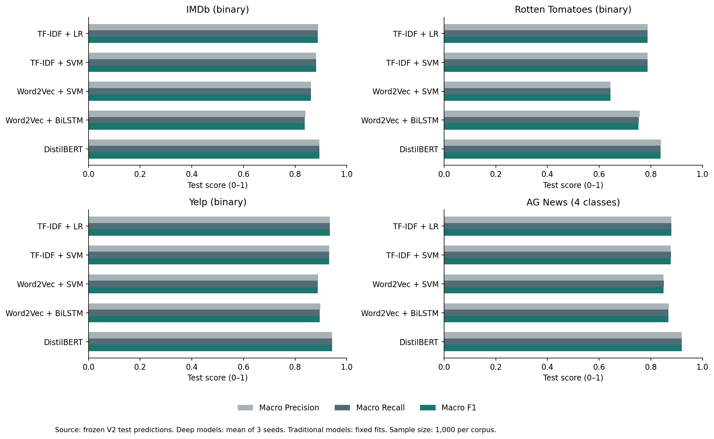

# 二分类与多分类更新结果

GUI已全部改为英文。新增AG News四分类（World、Sports、Business、Sci/Tech），并加入Word2Vec均值+SVM和Word2Vec初始化的BiLSTM。

每个数据集均使用6,000训练、1,000验证、1,000测试。现在共四数据集、五种方法，36个最终模型运行记录；深度模型分别运行三个种子。所有方法同时报告Accuracy、Macro/Micro/Weighted Precision、Recall、F1、MCC，以及每类指标、支持数和混淆矩阵。

## AG News实测结果

| Model | Accuracy | Macro Precision | Macro Recall | Macro F1 |
|---|---|---|---|---|
| TF-IDF + LR | 0.8800 | 0.8800 | 0.8800 | 0.8800 |
| TF-IDF + SVM | 0.8780 | 0.8775 | 0.8780 | 0.8776 |
| Word2Vec + SVM | 0.8500 | 0.8497 | 0.8500 | 0.8497 |
| Word2Vec + BiLSTM | 0.8680 | 0.8700 | 0.8680 | 0.8678 |
| DistilBERT | 0.9193 | 0.9200 | 0.9193 | 0.9195 |

详细英文报告见classification-report-v2.md。原有二分类结果保持不变，新增二分类方法属于查看旧测试结果后的扩展比较；新闻测试集为新保留的独立样本。不能把新闻与影评的分数差异全部归因于类别数不同。
