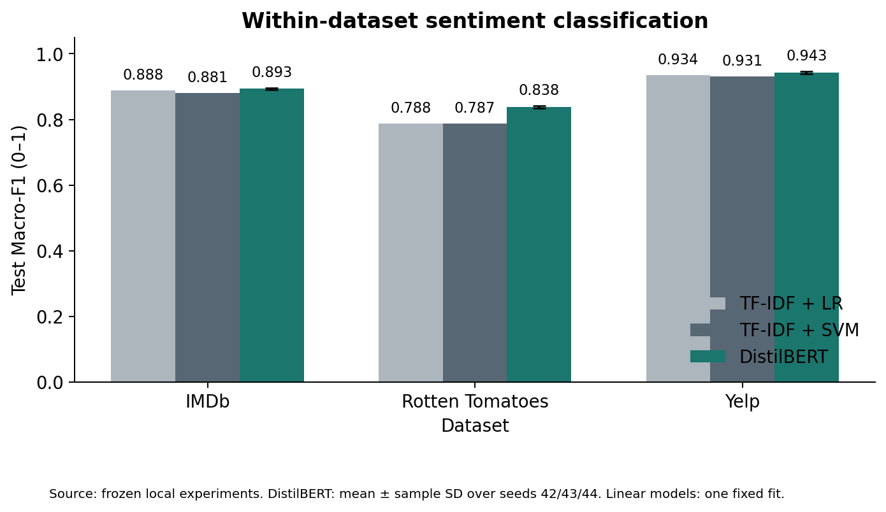
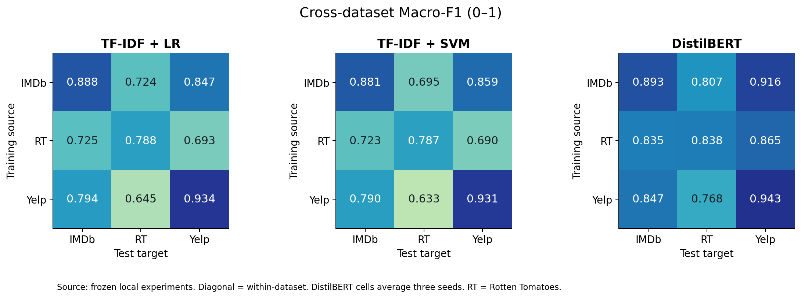
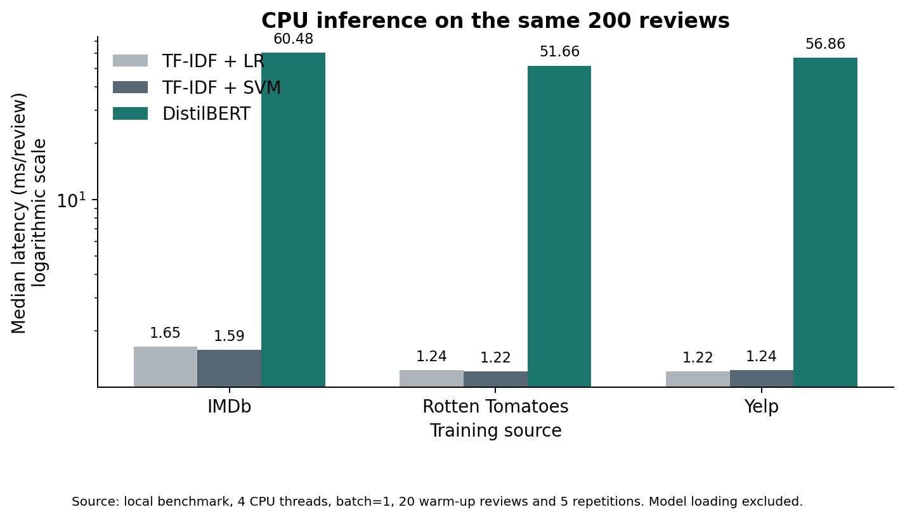

# 项目结果速览

这是已执行实验的结果摘要，不是预测成绩。完整方法、每类指标、逐种子记录与限制见 `experiment-report.md`。

## 已完成的计算实验

三数据集各6,000训练／1,000验证／1,000测试，共24,000条固定样本。36次传统候选拟合、12次 DistilBERT 训练，保留15个最终模型。冻结后完成45组来源—目标—种子评估，共45,000条预测记录，以及同一CPU上的推理计时。

## 同集测试

三个数据集等权平均 Macro-F1：TF-IDF + LR 0.8700; TF-IDF + SVM 0.8663; DistilBERT 0.8914。DistilBERT 的每集数值是三个训练种子的平均值，传统模型是固定配置的单次结果。

- IMDb：DistilBERT 0.8933，该集较强传统模型 0.8880，差值 +0.54 个百分点。
- Rotten Tomatoes：DistilBERT 0.8379，该集较强传统模型 0.7880，差值 +4.99 个百分点。
- Yelp：DistilBERT 0.9430，该集较强传统模型 0.9340，差值 +0.90 个百分点。

## 迁移与成本

训练来源按行、测试目标按列。模型直接迁移，不使用目标标签调整参数。两个电影语料的差异不应全称为领域差异，长度与文体也有影响。

计时使用同一CPU、四线程、相同200条评论、batch1、每条五次。包含清理和特征转换，不含模型加载。实际延迟和训练成本详见完整报告。

## 使用与提交

在项目目录运行 `python -m streamlit run app.py`，或双击 `start_app.cmd`。应用可输入英文评论、选择训练来源、比较三模型并查看实际实验结果。演示固定使用 seed42。

现有人工复核队列共60条，当前0条标为人工复核完成；未代填复核人。真人录制视频、核实个人贡献并签名、填写老师的正式GAI表、完成个人互评仍需真实成员执行。

## 解释边界

这里只比较抽样后的英文正负二分类，不是原论文全量复现。DistilBERT 使用额外预训练，且长文本截断；IMDb 测试截断率 39.8%，Rotten Tomatoes 0.0%，Yelp 21.6%。三种子标准差不是测试置信区间，模型概率未经额外校准。GPU 确定性设置有已记录的 CuBLAS 限制，不能承诺逐位重现。
