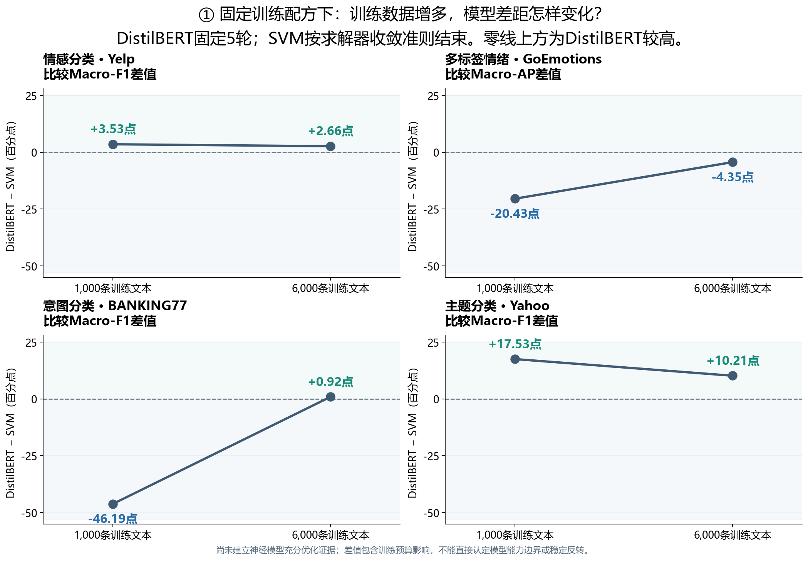
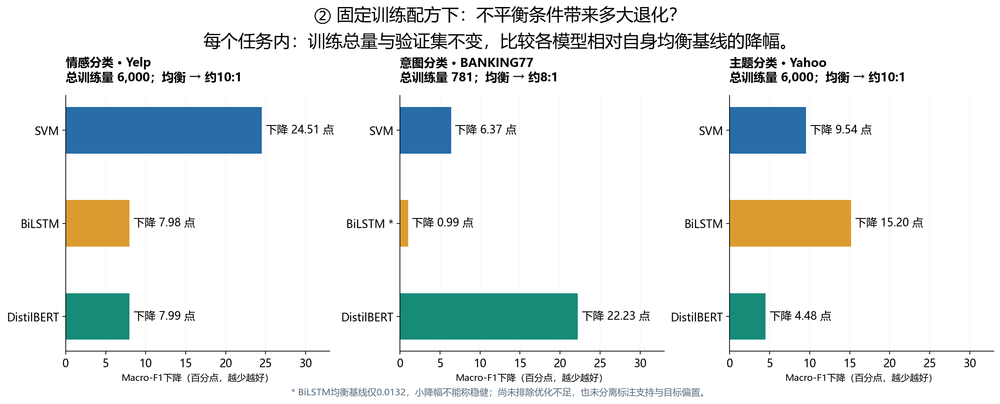
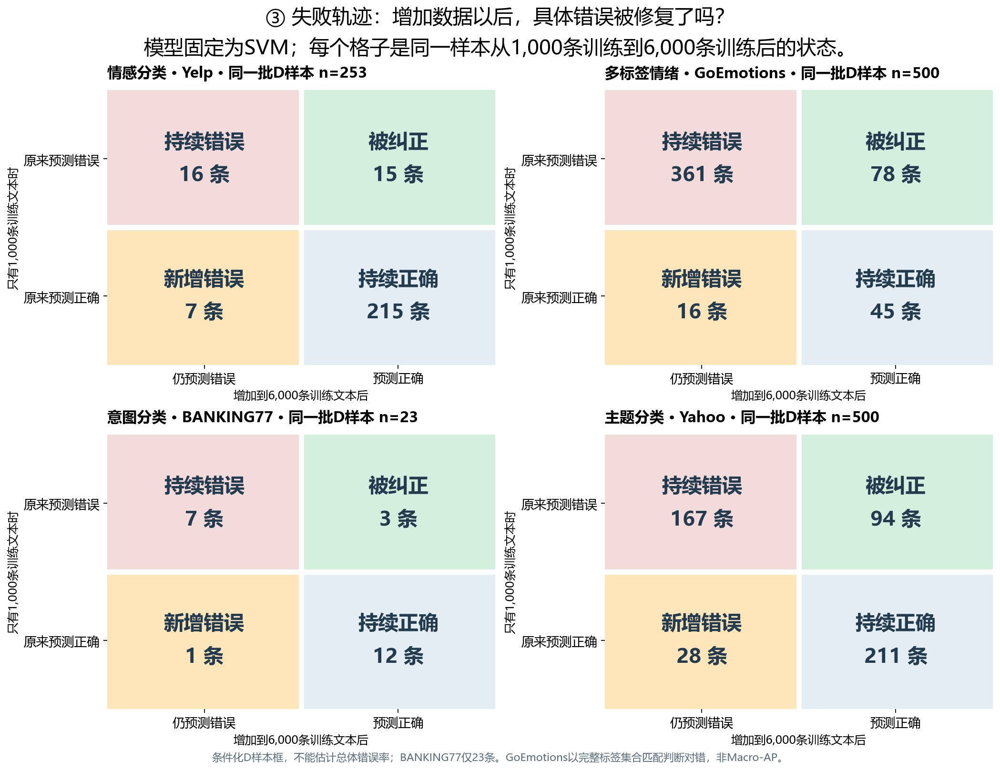
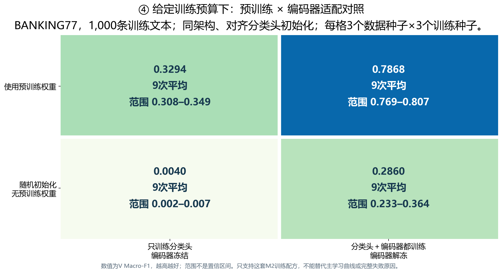
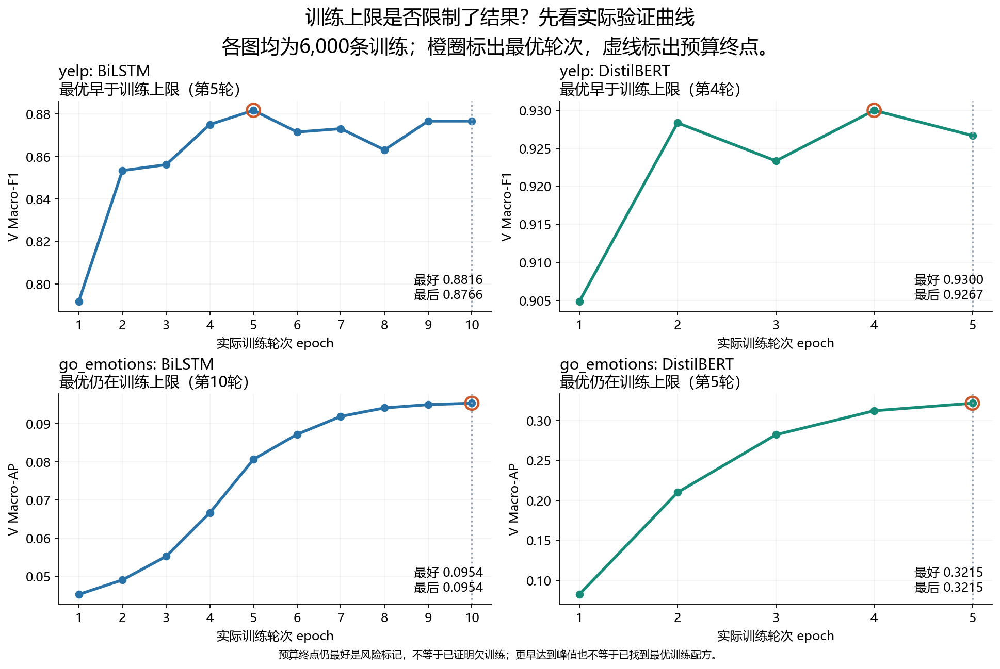

# 数据条件、失败轨迹及训练预算核查

所有图只使用已核验数据。前两张为固定训练配方下的观察；第三张追踪个体错误；第四张展示给定预算下的机制对照；第五张核查验证曲线。
神经模型充分优化尚未确认，当前结果不能直接认定模型能力边界；也没有正式Q结果。

## 样本量从1,000到6,000时，DistilBERT相对SVM的差距如何变化

## 固定每个任务的训练总量，比较均衡与倾斜训练的退化幅度

## 在同一批D样本上统计持续错误、纠错、新增错误和持续正确

## 同架构四臂，分别比较初始化与编码器适配

## 充分训练尚未确认：验证曲线是否仍受预算上限限制

[研究主图PDF](能力边界与失败机制-研究主图.pdf)

[研究问题、实际实验与证据缺口](../results-analysis-v1-zh.md)
