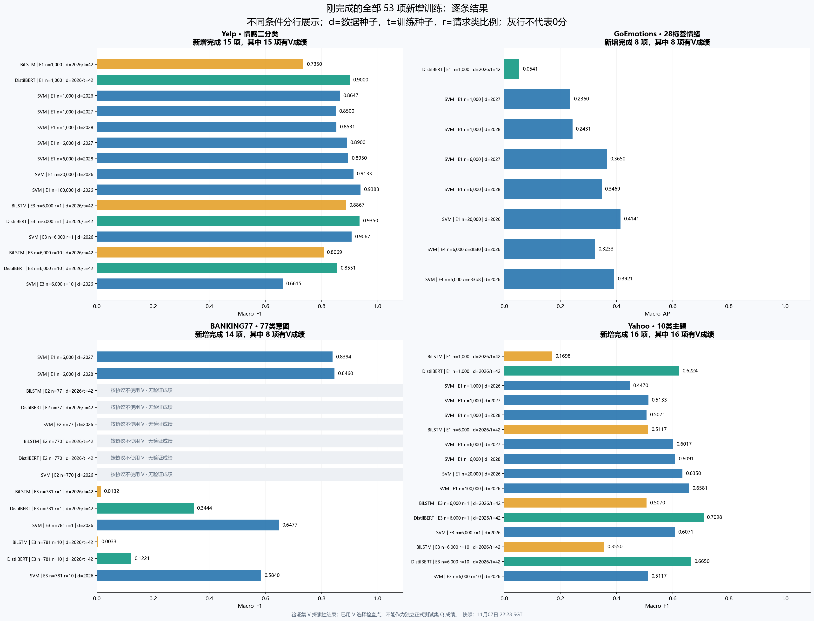
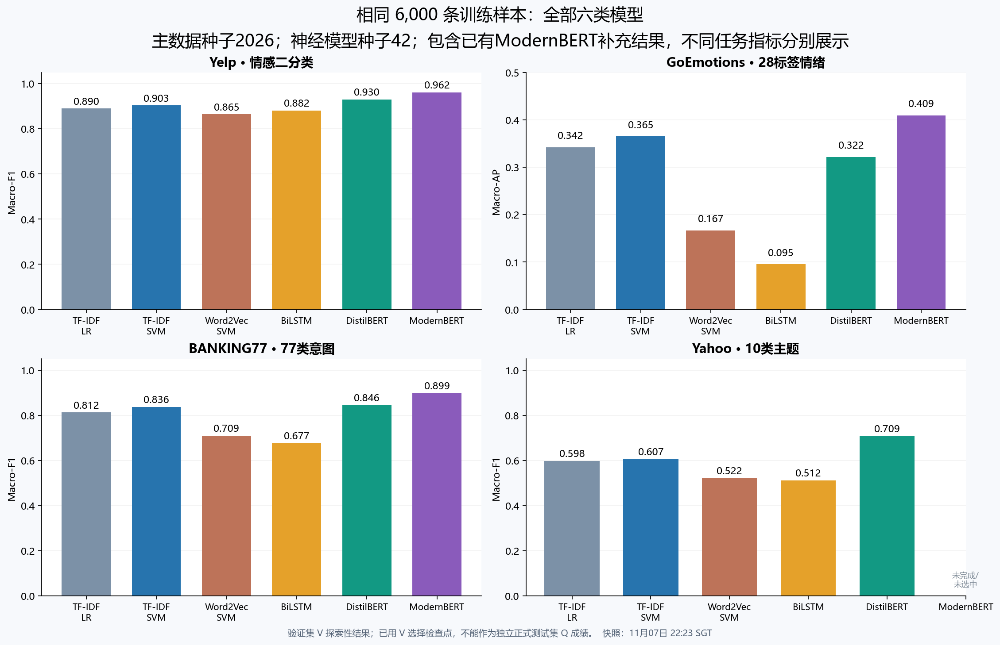
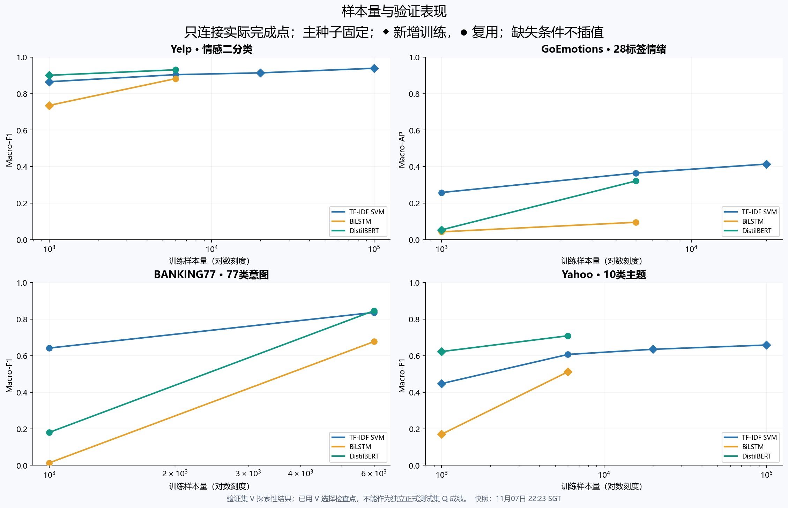
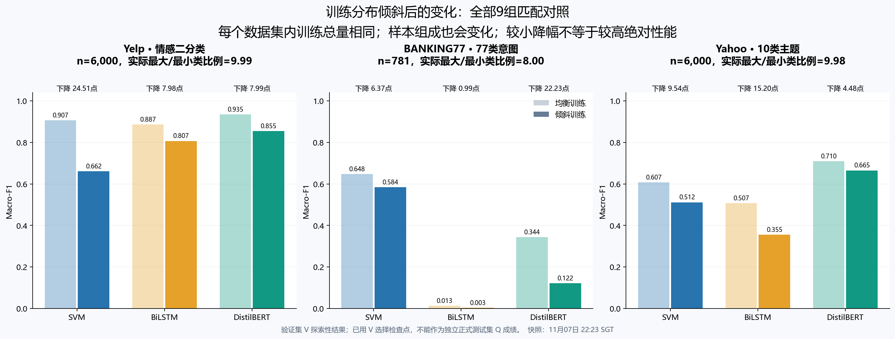
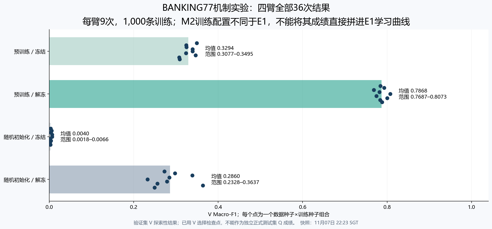
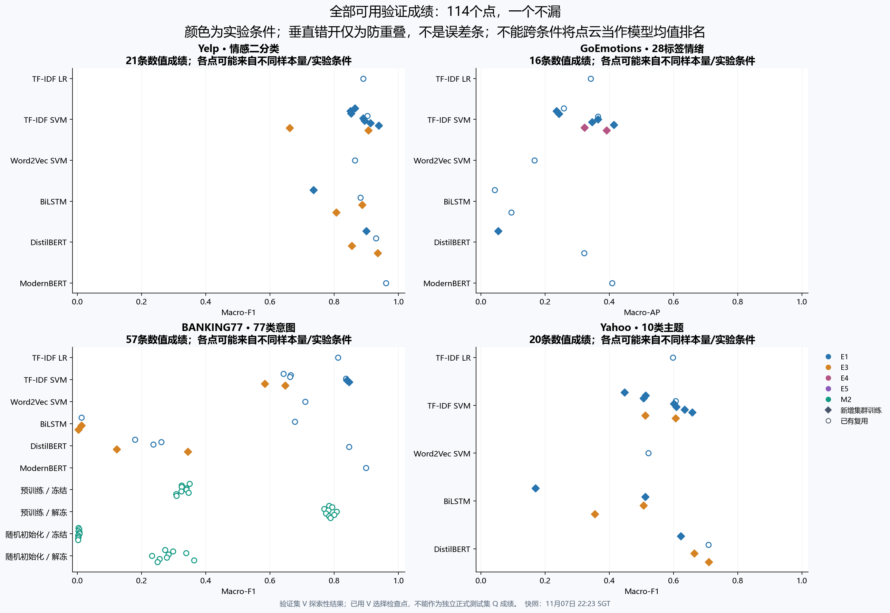
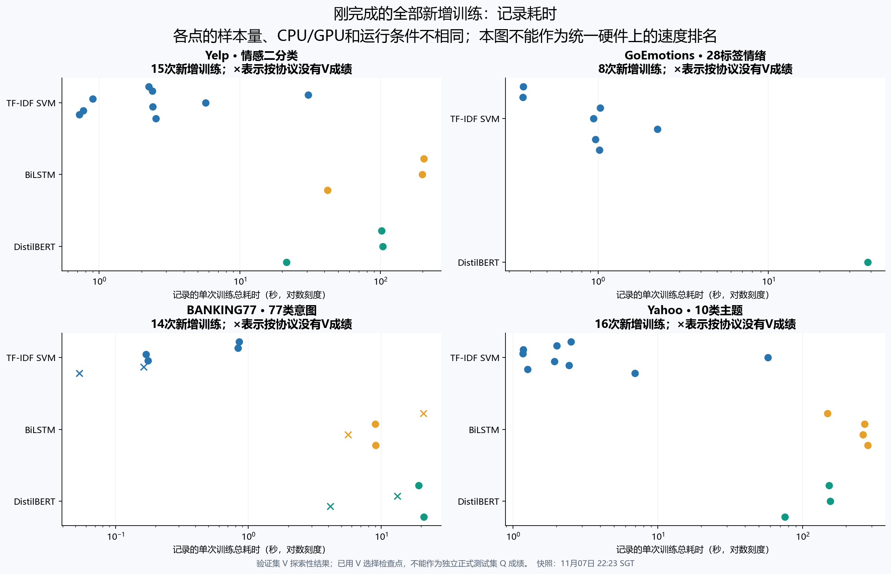
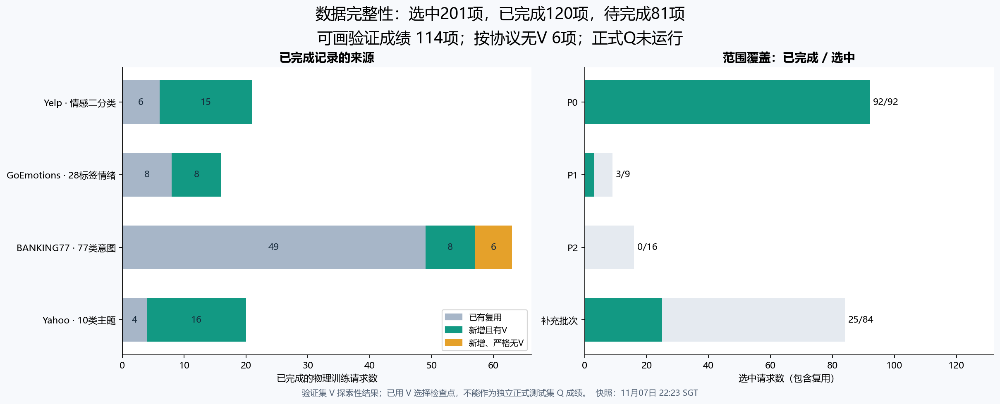

# 当前训练结果图表

建议先看[能力边界与失败机制研究主图](../charts-research/README.md)。本页保留全部逐条记录和补充模型，作为详细附录。

数据快照：2026-11-07T22:23:40.658541+08:00。
已完成120项：新增53项、复用67项；其中114项有V成绩、6项按协议不使用V。

全部图均为验证集探索性结果，正式Q没有运行。

[下载旧版8页明细图册](当前全部训练结果图表-旧版明细.pdf)

[全部已完成数据](all-completed-records.csv) · [新增训练数据](new-cluster-records.csv) · [来源与逐图覆盖记录](plot-manifest.json)

## 全部新增训练逐条结果

## 六类模型比较（含ModernBERT）

## 学习曲线

## 不平衡对照

## 机制实验36次重复

## 全部114条验证成绩

## 全部新增训练耗时

## 完成范围和缺失说明

