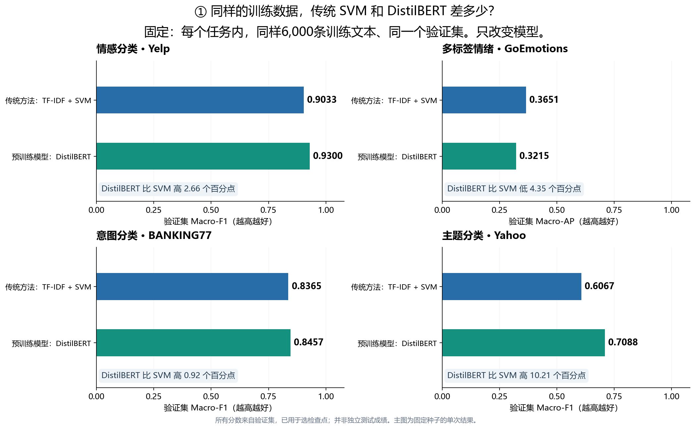
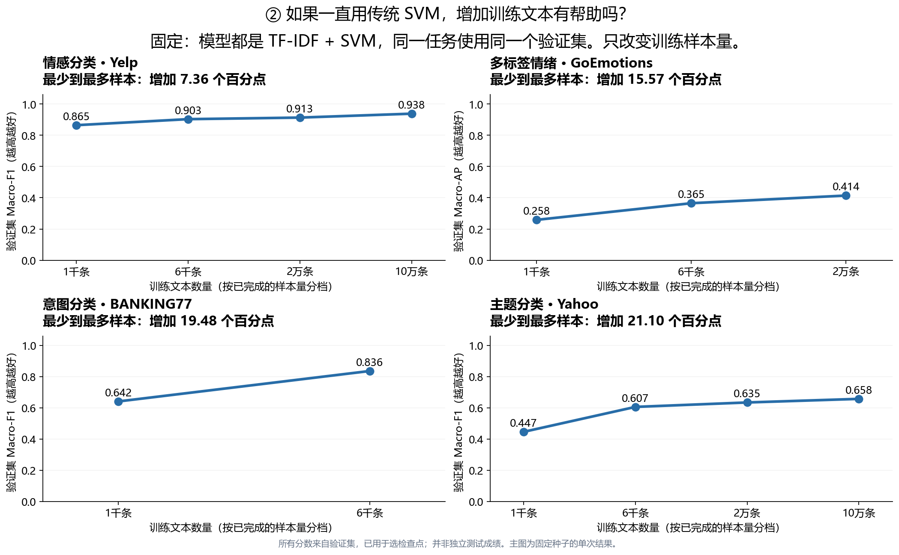
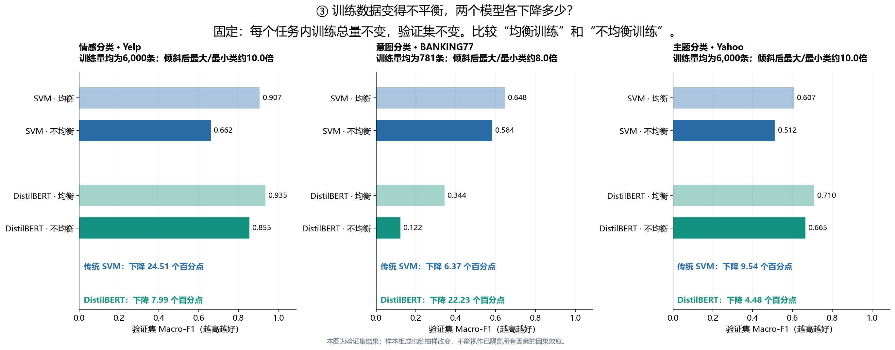
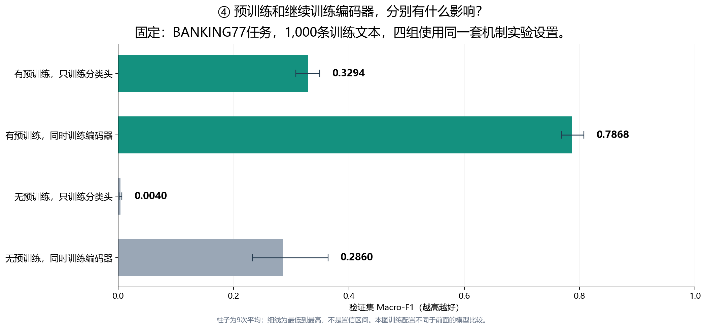

# 先看这四个问题

本页使用同一份已核对的结果快照重新排版。主图选用固定条件的比较；全部120项记录仍保留在附录。
所有性能数字来自验证集，不是独立正式测试成绩。数据快照为2026年11月7日22:23，新加坡时间。

## 1. 同样的数据，传统SVM和DistilBERT差多少？

每个小图只比较两种模型。两根柱子使用同样6,000条训练文本和同一个验证集；柱子越长，分数越高。
蓝色是传统SVM，绿色是DistilBERT。只在同一个小图内比较，GoEmotions与其他任务的指标不同。

## 2. 一直用SVM，增加训练文本有帮助吗？

模型保持不变，横轴是训练文本数量，纵轴是验证得分。每个小图只追踪一个任务。

## 3. 数据变得不平衡，分数下降多少？

分别比较SVM和DistilBERT在均衡与不均衡训练下的成绩；每个任务内总训练量保持相同。

## 4. 预训练和继续训练编码器，分别带来什么变化？

看同一个BANKING77机制实验中的四种训练方式。柱子是9次结果的平均，细线是最低到最高。
这是独立的机制实验配置，不能把它的分数拼入前面模型的学习曲线。

[全部逐条结果、其他模型及耗时：详细附录](../charts-v1/README.md)
