# 完整研究图册：阅读入口

[打开12页PDF](完整研究图册.pdf)：前置1页研究接续图，后接原11张结果主题图。新增接续页不算新实验。

[先读交接前后的连续论证](../../../../docs/RESEARCH-CONTINUITY.md)。交接前比较常规任务、MultiNLI和AG News长尾；当前继续追问规模、优化、预训练、标注支持与线索依赖。

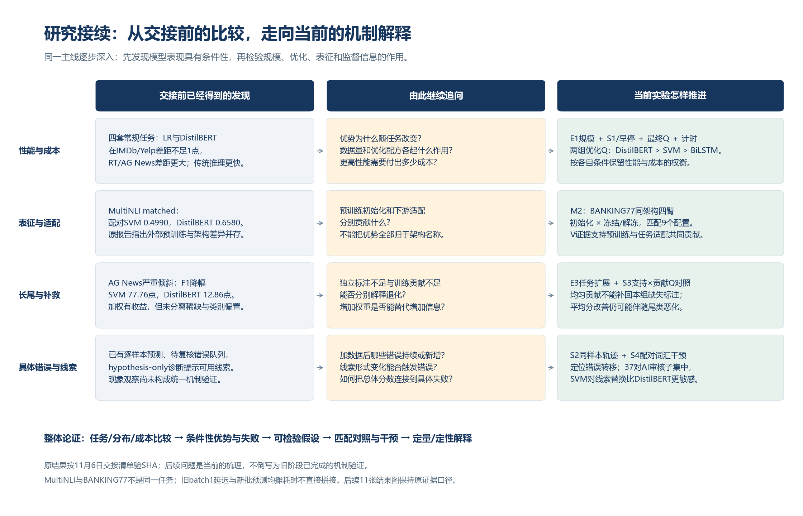

随后按“观察现象 → 检查优化 → 独立泛化 → 分解机制 → 观察错误 → 解释案例 → 计算成本”阅读。

| PDF页码 | 结果图 | 比较的问题 | 证据 |
| --- | --- | --- | --- |
| 02 | 01 | [增加数据能否改变模型优势？](01-数据规模与模型差距.png) | scale / V |
| 03 | 02 | [延长预算是否总能改善正式测试？](02-优化配方的Q敏感性.png) | S1 / Q |
| 04 | 03 | [最终模型是否只是被固定轮数截断？](03-实际训练与早停曲线.png) | optimized states / V |
| 05 | 04 | [优化能否消除所有模型差距？](04-优化后的正式Q比较.png) | primary + historical reference / Q |
| 06 | 05 | [预训练与适配分别贡献什么？](05-预训练与任务适配.png) | M2 / V |
| 07 | 06 | [是否存在跨任务一致的长尾鲁棒模型？](06-类别倾斜的任务差异.png) | E3 / V |
| 08 | 07 | [监督信息不足与训练贡献不足有何区别？](07-标注支持与尾类失效.png) | S3 / Q |
| 09 | 08 | [平均分改善背后发生了哪些样本转移？](08-逐样本错误迁移.png) | S2 / D |
| 10 | 09 | [原文表现与词汇稳定性是否相同？](09-词汇干预的配对比较.png) | S4 / AI-reviewed D |
| 11 | 10 | [相同编辑预算下，错误怎样发生？](10-词汇失败的具体案例.png) | S4 / qualitative D |
| 12 | 11 | [预测优势需要付出多少计算代价？](11-训练与推理成本.png) | optimized timing / CPU8 |

V为验证/选择集，D为探索与干预集，Q为固定模型的正式测试。旧固定预算结果用于发现现象，新优化Q用于已测条件下的泛化比较。

## 逐图解释

### 01 增加数据能否改变模型优势？

数据规模会改变模型差距；BANKING77的BiLSTM、DistilBERT在6k时明显改善。

旧固定预算探索：BiLSTM 10轮、DistilBERT 5轮；单配置无误差条。这里不是优化后Q学习曲线。 两个规模点不能定位精确临界样本量；各任务指标不合并排名。

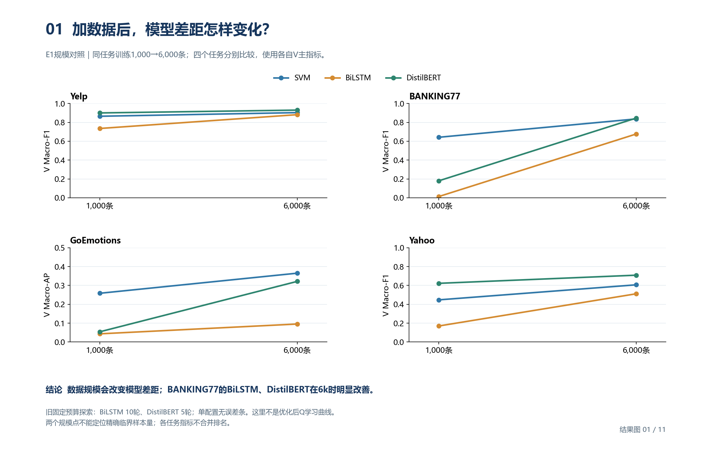

### 02 延长预算是否总能改善正式测试？

BANKING77 DistilBERT在lr=5e-5时提高30.88点；GoEmotions高学习率下AP基本持平。

单seed42；预算变化同时改变线性衰减计划，解释为配方/预算效应，不是纯轮数效应。 不同子图y轴范围不同；所有检查点在Q评估前已固定。

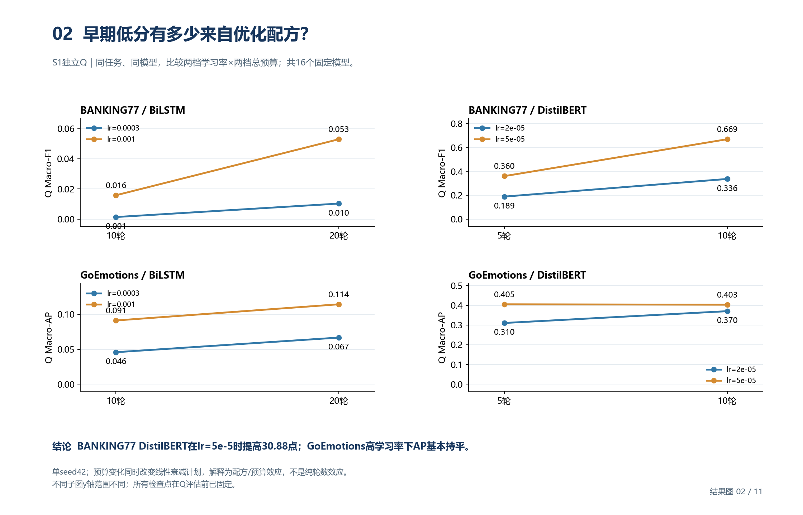

### 03 最终模型是否只是被固定轮数截断？

12个最终神经模型均触发patience早停；选中轮次与实际训练终止轮次分别记录。

BANKING77 1k、GoEmotions 6k；仅展示V选定配方的三个种子，未展示全部未选学习率。 早停表示满足既定停止准则，不等于证明全局最优。未用Q逐轮挑选检查点。

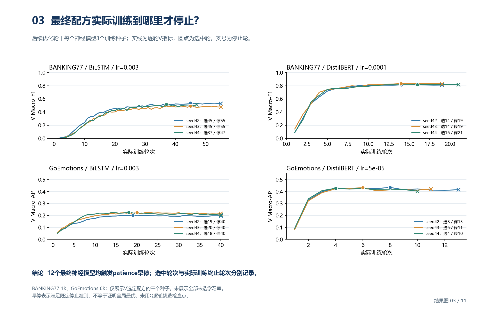

### 04 优化能否消除所有模型差距？

两组已测条件均为DistilBERT > SVM > BiLSTM，三个神经训练种子保持相同排序。

彩柱为均值；神经n=3、误差条为训练种子样本SD，散点为每个种子；SVM确定性单次。SD不是测试置信区间。 灰菱形共4个历史Q参考；新旧配方同时改变学习率/预算/调度，不把差距全归于训练轮数。

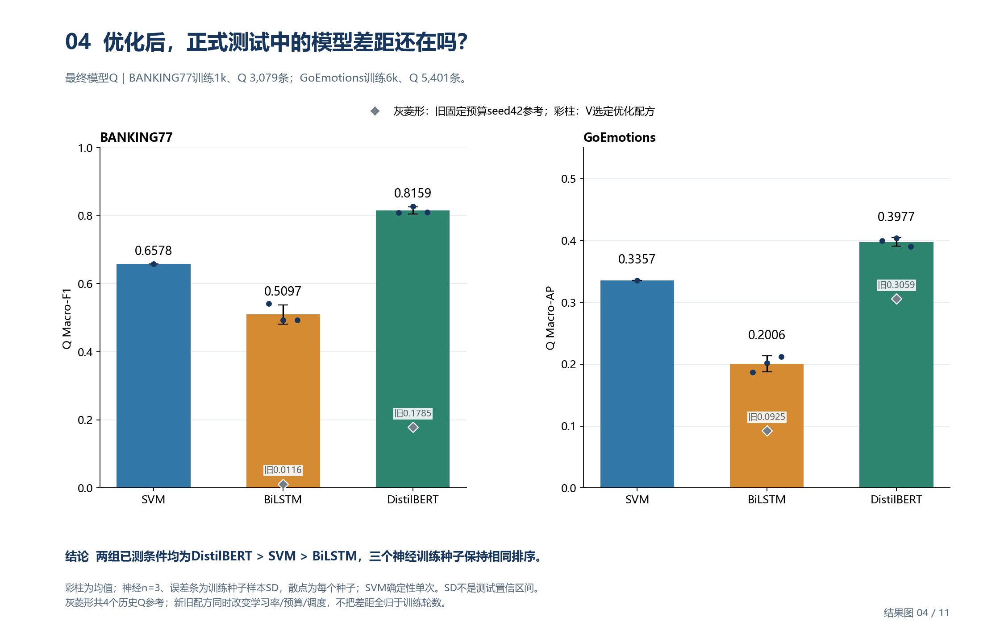

### 05 预训练与适配分别贡献什么？

解冻时预训练提高50.08点；预训练后解冻提高45.74点，两个方向均在9/9成对配置中成立。

每臂3个数据抽样×3个训练种子，点为配置、柱为均值、误差条为配置间样本SD。 这是V机制证据，未包含在42个Q模型中；不把9个配置当作9个独立任务。

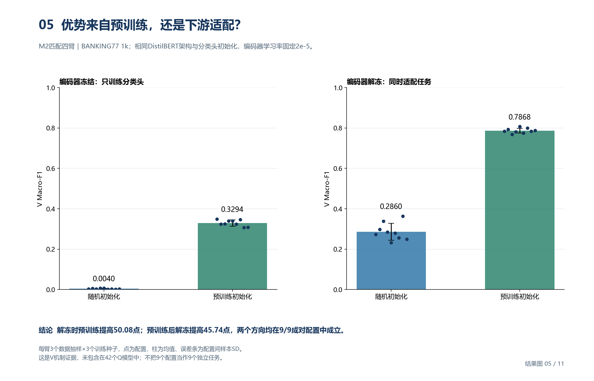

### 06 是否存在跨任务一致的长尾鲁棒模型？

Yelp上SVM退化更大，BANKING77上DistilBERT退化更大；鲁棒性排序随任务变化。

实心为均衡、空心为倾斜；原固定预算V结果，包含优化因素。 BANKING77 BiLSTM均衡F1仅0.0132，小降幅不能称稳健；标注支持和类别贡献尚需S3分开检验。

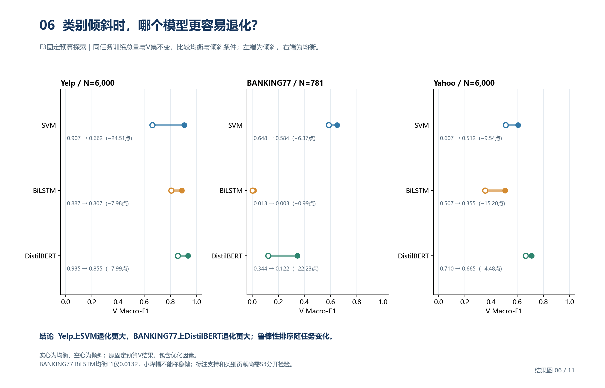

### 07 监督信息不足与训练贡献不足有何区别？

均匀贡献无法补回独立标注；冻结头整体F1提升0.044→0.103时，尾类召回4.8%→0.4%。

SVM固定总权重781，冻结头固定245次更新；尾类集合事先定义，各格单seed。 不同固定表示不作端到端模型排名；整体Macro-F1改善也可能掩盖局部失效。

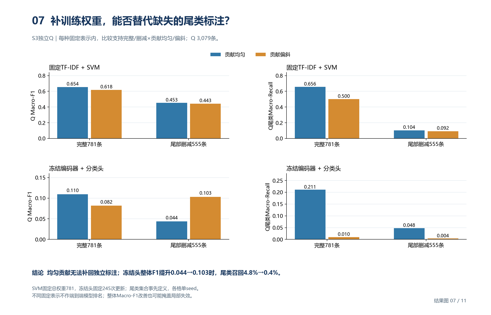

### 08 平均分改善背后发生了哪些样本转移？

增加数据能纠错，也会引入新错；四任务的DistilBERT都仍有持续错误样本。

旧固定预算检查点；持续错误不等于优化后不可解。BANKING77 D仅23条。 GoEmotions以0阈值完整标签集合判断整条对错，其他任务为单标签；不能跨任务比较“错误率”。

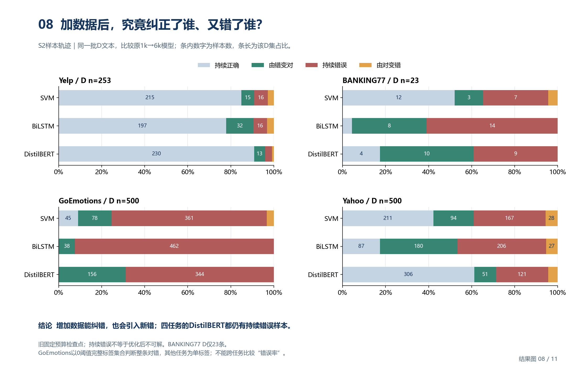

### 09 原文表现与词汇稳定性是否相同？

本组线索替换使SVM损失24.32点、DistilBERT损失8.11点；原文排名不能代表扰动稳定性。

37对由Gemini两个表格版本审核，按AI辅助子研究报告；不是双真人独立复核。 这是筛选出的可改写D子集，不代表整个任务的扰动发生率；误差条未作推断。

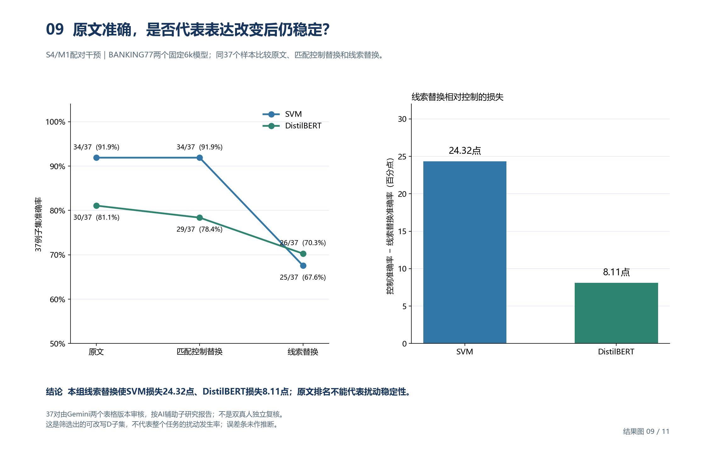

### 10 相同编辑预算下，错误怎样发生？

转账案例中DistilBERT保持正确，退款同义替换却令两模型都错：相对稳定不等于完全不敏感。

案例M1-013、M1-019来自同一37对AI审核干预集；仅解释失败形式，不估计总体频率。 正确/错误由保存的逐例预测与金标签重建，未重新运行模型。

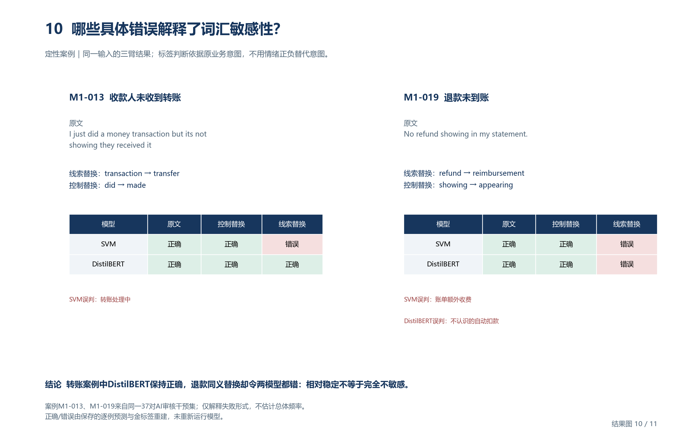

### 11 预测优势需要付出多少计算代价？

本轮SVM成本最低；DistilBERT取得更高Q分数，同时付出更高的训练与批预测成本。

点为各种子，横线为中位数；训练为既有资产下单模型流程，含特征/验证/保存，不含预训练与全网格搜索。 预测不含加载/校验/清理，均摊时间不是在线延迟。共享CPU实测；BANKING77 DistilBERT seed43训练含续跑重建。

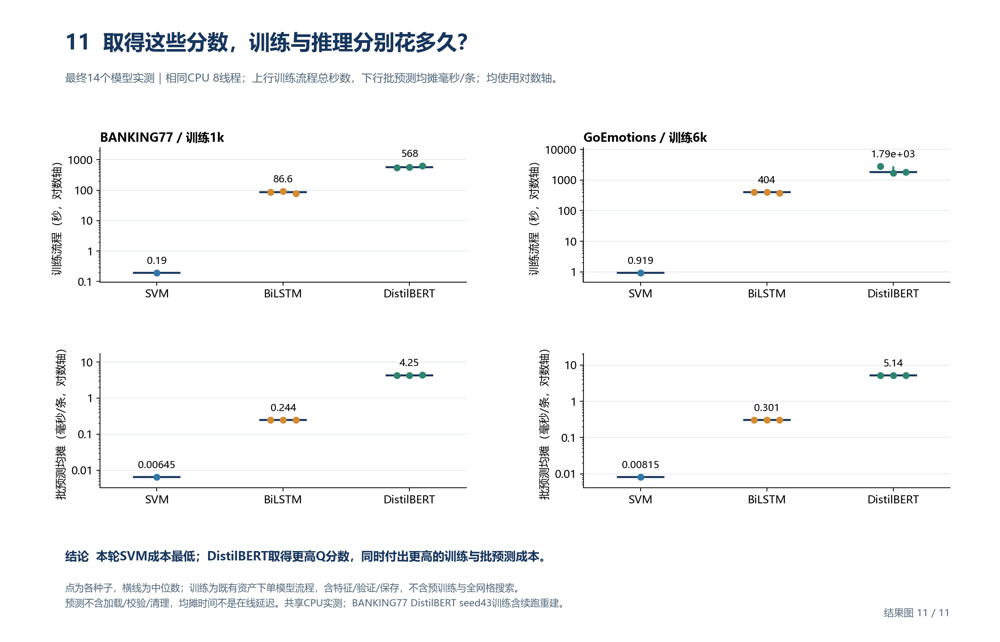

## 来源与复现

[逐图数据及SHA](figure-data.json)保存每张图实际使用的数据、模型ID和全部输入指纹。[生成脚本](build-atlas.py)仅读取已保存结果。

[现有完整数值分析](../results-analysis-v1-zh.md)、[研究主线](../../../RESEARCH.md)。

`support/`只存PDF渲染与排版核验，不计作研究图。
