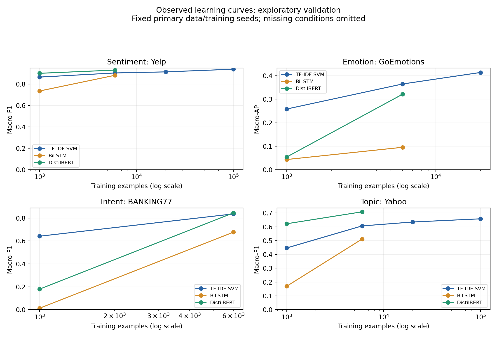

# 已有结果分析第一版：传统文本分类与深度模型

编写日期：2026年11月7日，新加坡时间。分析使用已落盘的结果快照，快照时间为当日21:43:11（UTC 13:43:11）。

**本版可支持的结论是：模型优势随任务、训练样本量和训练配置变化，现有证据不支持“深度模型在所有文本分类任务上都更好”。本版全部性能数字来自验证集 V，不能当作独立正式测试集 Q 的成绩。**

## 1. 数据范围与可信程度

当前一晚计划及补充计划共选中201个不重复的物理训练请求，包括67个已有检查点复用、134个新增训练请求。结果快照收录了53个新增训练完成记录，因此本版覆盖120个已完成请求；另外81个新增请求尚未纳入本版结果。

| 数据集 | 已完成请求 | 有数值的V成绩 | 按协议不使用V的请求 |
| --- | ---: | ---: | ---: |
| Yelp | 21 | 21 | 0 |
| GoEmotions | 16 | 16 | 0 |
| BANKING77 | 63 | 57 | 6 |
| Yahoo Answers Topics | 20 | 20 | 0 |
| 合计 | 120 | 114 | 6 |

BANKING77的6个无V请求属于严格少样本实验：每类1条或10条训练样本，分别共77条、770条，覆盖SVM、BiLSTM和DistilBERT。这些实验明确设置了 `strict_no_val=true`，成绩为空符合协议，不能填成0，也不能为得到结果而临时使用验证集。

本次逐项核对了120条请求身份和指标来源。其中67个复用请求的本地 `status.json` SHA256与计划绑定值一致，并确认状态为完成且已通过保存重载；53个新增请求的指标或无V状态与集群导出的完成快照一致。9组不平衡对照的两臂成绩和差值也已核对。本次没有重新读取全部模型权重，也没有重新运行模型推理。

来源：[完整明细](current-validation-results.csv)、[新增训练结果快照](latest-cluster-results.json)、[本版核验记录](results-analysis-v1-evidence.json)。

## 2. 相同训练样本量下的模型比较

以下统一采用E1条件下6,000条训练样本、数据种子2026；神经模型训练种子为42。表中每格为一个已有模型的V成绩，不是多种子均值。

| 数据集 | 指标 | TF-IDF LR | TF-IDF SVM | Word2Vec SVM | BiLSTM | DistilBERT | DistilBERT减TF-IDF SVM |
| --- | --- | ---: | ---: | ---: | ---: | ---: | ---: |
| Yelp | Macro-F1 | 0.8900 | 0.9033 | 0.8650 | 0.8816 | 0.9300 | +2.66个百分点 |
| GoEmotions | Macro-AP | 0.3424 | 0.3651 | 0.1666 | 0.0954 | 0.3215 | −4.35个百分点 |
| BANKING77 | Macro-F1 | 0.8123 | 0.8365 | 0.7093 | 0.6768 | 0.8457 | +0.92个百分点 |
| Yahoo Answers Topics | Macro-F1 | 0.5982 | 0.6067 | 0.5216 | 0.5117 | 0.7088 | +10.21个百分点 |

Yelp上，预训练DistilBERT领先，但SVM已有较高成绩。BANKING77上两者更接近，尚不能把不足1个百分点的单次差距写成稳定优势。Yahoo上，当前DistilBERT相对SVM的差距最大。

GoEmotions是28标签多标签任务，主指标为Macro-AP。当前SVM高于DistilBERT，LR也高于DistilBERT；BiLSTM的表现较低。因此，这组实验尤其不支持把“深度学习”作为统一的优势来源。任务标签支持、文本线索、训练预算等可能与差异有关，但这些解释还没有被当前汇总成绩单独验证。

四个任务不能把Macro-F1与Macro-AP直接平均成一个总榜。各模型曾使用V选择检查点，V结果也不是独立测试证据。

## 3. 样本量变化：哪些趋势已经可以观察

以下仍使用主数据种子2026和神经模型训练种子42。横线表示该条件尚无本版可用结果，不能插值或当成训练失败。

| 数据集与模型 | 1,000条 | 6,000条 | 20,000条 | 100,000条 |
| --- | ---: | ---: | ---: | ---: |
| Yelp / SVM | 0.8647 | 0.9033 | 0.9133 | 0.9383 |
| Yelp / BiLSTM | 0.7350 | 0.8816 | — | — |
| Yelp / DistilBERT | 0.9000 | 0.9300 | — | — |
| GoEmotions / SVM，Macro-AP | 0.2584 | 0.3651 | 0.4141 | — |
| GoEmotions / BiLSTM，Macro-AP | 0.0433 | 0.0954 | — | — |
| GoEmotions / DistilBERT，Macro-AP | 0.0541 | 0.3215 | — | — |
| BANKING77 / SVM | 0.6417 | 0.8365 | — | — |
| BANKING77 / BiLSTM | 0.0129 | 0.6768 | — | — |
| BANKING77 / DistilBERT | 0.1797 | 0.8457 | — | — |
| Yahoo / SVM | 0.4470 | 0.6067 | 0.6350 | 0.6581 |
| Yahoo / BiLSTM | 0.1698 | 0.5117 | — | — |
| Yahoo / DistilBERT | 0.6224 | 0.7088 | — | — |

已有点位中，训练样本增多通常伴随更高V成绩。Yahoo上，DistilBERT用6,000条得到0.7088，而SVM用100,000条得到0.6581，这提示该固定配置下存在值得追踪的样本效率差异，但不能等同为等计算预算比较。Yelp上，100,000条SVM的0.9383高于6,000条DistilBERT的0.9300；由于样本量不同，不能用这个比较直接认定模型优劣。

BANKING77的1,000条E1神经模型成绩很低，说明不能仅凭6,000条主表描述小样本表现。这里同时存在训练配置影响，尤其不能把下节M2机制实验的高分移到本节学习曲线上。

图中连线只连接已观察点，缺失的更大样本神经模型结果尚不能支持曲线交叉位置或最终上限判断。[PDF图](current-learning-curves.pdf)

## 4. 不平衡训练：下降幅度依赖数据集和模型

以下是E3内部匹配对照，保持每个数据集两种训练分布的总样本量相同，主数据种子2026、神经模型训练种子42。这里的均衡模型与E1的自然抽样模型身份不同，不能互相替换。

| 数据集 | 训练总量 | 模型 | 均衡V Macro-F1 | 倾斜V Macro-F1 | 倾斜减均衡，百分点 |
| --- | ---: | --- | ---: | ---: | ---: |
| Yelp | 6,000 | SVM | 0.9067 | 0.6615 | −24.51 |
| Yelp | 6,000 | BiLSTM | 0.8867 | 0.8069 | −7.98 |
| Yelp | 6,000 | DistilBERT | 0.9350 | 0.8551 | −7.99 |
| BANKING77 | 781 | SVM | 0.6477 | 0.5840 | −6.37 |
| BANKING77 | 781 | BiLSTM | 0.0132 | 0.0033 | −0.99 |
| BANKING77 | 781 | DistilBERT | 0.3444 | 0.1221 | −22.23 |
| Yahoo | 6,000 | SVM | 0.6071 | 0.5117 | −9.54 |
| Yahoo | 6,000 | BiLSTM | 0.5070 | 0.3550 | −15.20 |
| Yahoo | 6,000 | DistilBERT | 0.7098 | 0.6650 | −4.48 |

Yelp上，两个神经模型相对各自均衡基线的下降都小于SVM；Yahoo上，DistilBERT下降较小，但BiLSTM下降较大。BANKING77上，SVM保留的绝对成绩更高，DistilBERT下降更大；BiLSTM的下降较小主要发生在原本就很低的基线上，不能解释成稳健。

请求的最大/最小类比例为10，但抽样后实际比例分别约为Yelp 9.989、Yahoo 9.980、BANKING77 8.0。BANKING77的均衡臂每类10或11条，倾斜臂最少3条、最多24条，因此还受很小的每类支持量约束。BANKING77和Yahoo的类别头尾顺序也发生了变化。

这些对照反映训练分布变化下的验证表现，同时包含样本组成变化，不能称为已经隔离所有其他因素的纯先验因果效应。暂时不能推广为“所有深度模型更抗不平衡”。

## 5. 已有机制对照：预训练与解冻的作用

BANKING77，1,000条训练，M2专用 `m2_distilbert` 四臂实验。每臂9次，来自3个数据种子与3个训练种子的组合。

| 初始化与编码器训练方式 | V Macro-F1均值 | 最小–最大 |
| --- | ---: | ---: |
| 预训练、冻结编码器 | 0.3294 | 0.3077–0.3495 |
| 预训练、解冻编码器 | 0.7868 | 0.7687–0.8073 |
| 随机初始化、冻结编码器 | 0.0040 | 0.0018–0.0066 |
| 随机初始化、解冻编码器 | 0.2860 | 0.2328–0.3637 |

在该机制配置下，预训练且解冻的组合表现最高；仅冻结预训练编码器没有得到同等表现。这支持“预训练信息与编码器适配都与收益有关”的有限结论。

**M2与E1不属于同一训练配置。**M2设分类头学习率0.001、编码器学习率0.00002，训练10个epoch；E1主配置使用学习率0.00002、最多5个epoch。因此，M2的0.7868不能替代E1同样1,000条训练时的0.1797，也不能把两者差距单独归因于某个因素。上表极差不是置信区间，本版未进行显著性检验。

## 6. 现在可以写入报告的结论及边界

可以写：在当前固定配置和验证集上，传统稀疏特征模型仍有竞争力，预训练Transformer的收益随任务变化；GoEmotions出现与其他任务不同的排序。不平衡下的模型相对下降也呈任务差异。BANKING77的已有四臂实验进一步表明，预训练和编码器适配需要结合具体训练配置讨论。

暂时不能写：上述差距已在独立测试集成立；所有差距具有统计显著性；所有深度模型都更稳健；严格少样本实验已经有性能结论；模型差异已经由人工案例归因解释；本版已经证明性能与计算成本的最优取舍。

主表大多是单种子点估计，完整重复尚未齐备。新增模型权重的本地 `status.json` 当前均未同步，本版新增成绩依据集群导出快照；这不影响读取已有数值，但不足以宣称已经在本机复现这些模型。正式人审仍为pending，本地也尚无 `selection.lock.json` 或 `evaluation.freeze.json`。

## 7. 测试是否需要在集群上

**不强制在集群。**需要区分以下工作：

| 工作 | 是否需要集群或GPU | 当前适合的做法 |
| --- | --- | --- |
| 汇总已有指标、画图、写分析 | 不需要 | 在本机读取已导出的结果，本版即采用此方式 |
| 代码单元测试、数据与指标一致性核验 | 通常不需要；个别硬件测试例外 | 使用对应依赖环境在本机运行；本次完成的是数据一致性核验，没有重跑整个测试套件 |
| 已训练模型的离线批量推理 | 不强制；深度模型通常用GPU更快 | 需要权重、输入与兼容环境；可在本机或集群计算节点做 |
| 正式保留测试集Q评估 | 地点不是限制，评估协议是限制 | 先完成人审、模型与阈值冻结等前置条件，再执行已冻结范围的评估 |
| 延迟、吞吐量等性能比较 | 不强制使用集群，但必须明确并统一硬件与测量设置 | 分硬件报告，不能混合本机和集群时间作为同一成本结论 |

当前v3深度模型的保存重载评分入口会沿用模型包内的设备配置，因此“CPU在原理上可以推理”不等于当前CUDA检查点可以不经适配直接切到CPU。若以后需要CPU评估，应在独立的运行配置中适配并验证输出一致性，不修改已冻结权重或冒充重训。本版不需要加载模型，也不需要启动正式Q推理。

EEE官方说明要求：集群上的重计算不能放在登录节点；批量CPU/GPU任务通过Slurm在计算节点执行。CPU批作业可以不请求GPU，GPU作业必须指定一种GPU型号。规则约束集群资源的使用方式，没有要求研究的测试必须发生在集群上。[官方规则](https://github.com/NTUEEECluster/docs/blob/main/skill.md)、[Slurm作业说明](https://github.com/NTUEEECluster/docs/blob/main/slurm-guide.md)

本版不需要等GPU排队，可以作为现阶段报告的结果分析草稿。后续若新增结果到齐，按原预定对照更新对应表格，并保留版本与来源；在正式Q评估前，保持本版“验证集探索性分析”的身份。
